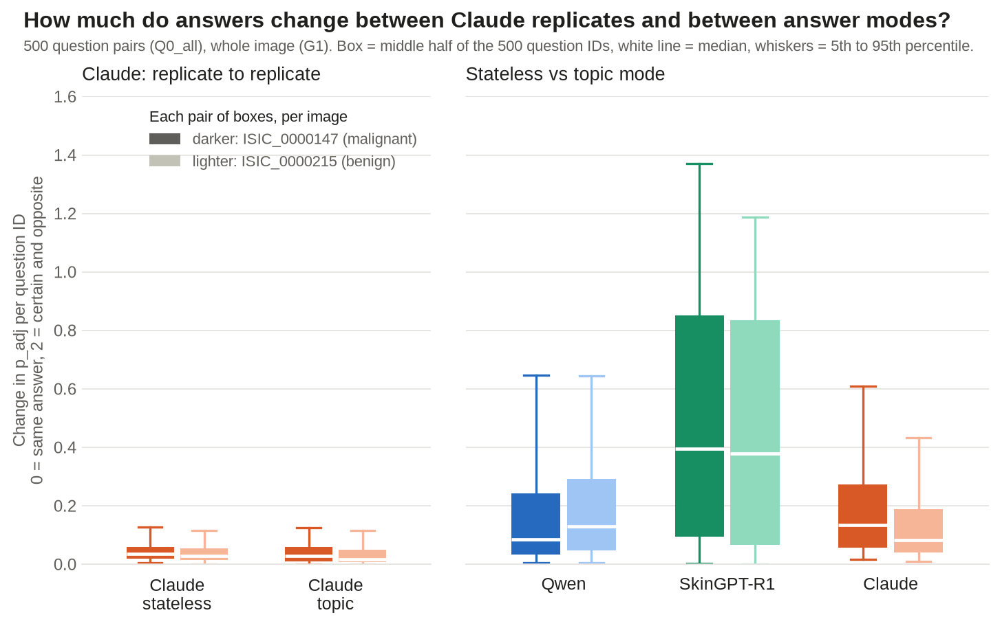

# Claude proof of concept: 2 images, 3 answerers, 4 Claude replicates (2026-10-30)

**Write-up as a scientific letter, with the follow-up shuffle experiments and Figures 1–5:** [letter.md](letter.md). This README is the working report for the first batch.

**Question:** how do Claude's answers compare with Qwen's and SkinGPT-R1's on the same two images and the same
500 question pairs? How consistent is Claude between replicates and between ways of asking?

**Data:** [compare/compare_answers.csv](compare/compare_answers.csv)
(one row per image × question, 1,000 rows); full run list under [Runs covered](#runs-covered).

## Setup

| Setting | Value |
|---|---|
| Images (`D0_poc2`) | ISIC_0000147 (malignant) and ISIC_0000215 (benign) |
| Questions (`Q0_all`) | all 500 questions, each asked as written and as its negated complement (1,000 items per image) |
| Image area (`G1`) | whole image only |
| Answerers | Qwen2.5-VL-7B (`ANS_qwen7b`) and SkinGPT-R1 (`ANS_skingpt_r1`): local, P(yes) read from the Yes/No word probabilities, deterministic so one run each. Claude Opus 5.5 (`ANS_claude_opus_cli`): through `claude -p` on the Claude subscription, effort low, states its P(yes) and confidence as JSON; 4 replicates (`R1`–`R4`) |
| Modes | `M_stateless`: one question per prompt. `M_topic`: one prompt per topic, listing that topic's questions; originals and complements in separate prompts |

Qwen and SkinGPT were run on 10 images on 2026-10-29. This comparison uses their rows for the two images above.
Claude's columns are the **mean of its 4 replicates**. They come with an SD column and `verdict_agreement`, the
share of replicates that gave the most common verdict.

**Verdict** for a question pair: *yes* when the model said yes to the question and no to its negation; *no* for the
reverse; a *contradiction* when it gave the same answer to both. p_adj = P(yes | question) − P(yes | negation),
from −1 (clearly no) to +1 (clearly yes).

## Validity checks

- **Every answer is present.** All 1,000 rows have values for all six answerer × mode columns. Claude returned a complete,
  numeric answer for every prompt in all 8 runs, so nothing was missing or refused.
- **The 8 Claude runs:** 4 topic runs of 164 prompts each and 4 stateless runs of 2,000 prompts each. They ran from
  2026-10-30-00:21:57 to 2026-10-30-06:04:21. The queue paused once, at the 5-hour usage limit
  (2026-10-30-02:51:38), and resumed on its own at 2026-10-30-05:15:02.

## Results

**1. Claude almost never contradicts itself.** It gave the same answer to a question and to its negation in **3.8%**
(stateless) and **3.2%** (topic) of pairs. Qwen did so in 78–92% of pairs and SkinGPT-R1 in 50–54%.

| Verdict share | Qwen stateless | Qwen topic | SkinGPT stateless | SkinGPT topic | Claude stateless | Claude topic |
|---|---|---|---|---|---|---|
| yes | 15.9% | 5.8% | 22.5% | 9.4% | 19.0% | 14.4% |
| no | 5.7% | 2.0% | 27.7% | 36.3% | 77.2% | 82.4% |
| contradiction: no to both | 74.6% | 91.7% | 37.0% | 46.8% | 3.2% | 2.7% |
| contradiction: yes to both | 3.8% | 0.5% | 12.8% | 7.5% | 0.6% | 0.5% |

**2. Claude is consistent between replicates.** The same verdict came back in all 4 replicates for **92.1%** of pairs
(stateless) and **94.6%** (topic). Across replicates, p_adj correlates at r = 0.99. A typical answer moves by
about 0.02–0.03 between replicates (mean SD).

**3. How Claude is asked matters little.** Stateless and topic give the same verdict for 90.6% of pairs, and p_adj
correlates at r = 0.92 between the two modes. For Qwen the two modes agree on 78% of verdicts, but only because both
mostly contradict. For SkinGPT-R1 they agree on 48%.

**4. The three models largely disagree with one another.** p_adj correlates at only r = 0.34–0.43 between Claude and
either local model. Claude's verdict matches Qwen's for 8–13% of pairs and SkinGPT-R1's for 35–40%.
These figures show disagreement, not who is right: there is no ground truth for individual answers.

**5. Claude's answers differ between the two images,** as they should for two different lesions. Matched question by
question, Claude's p_adj on the two images correlates at r = 0.58–0.62. It said "yes" to 22% of pairs for the
melanoma (ISIC_0000147) and 16% for the benign image (stateless).

**6. Where the variability sits, per question ID.** The measure is how much p_adj changes for a question
(0 = same answer, 2 = certain and opposite), shown separately for each image. Claude comparisons use single
replicates, never replicate means. Claude's replicate-to-replicate change averages **0.03–0.05**. Stateless vs topic
averages 0.14–0.20 for Claude, 0.17–0.20 for Qwen and 0.48–0.50 for SkinGPT-R1. So for Claude, the choice of mode
moves answers about 4× more than rerunning does. SkinGPT-R1 depends most on how it is asked. The two images give
similar spreads. (Differences between models are larger still, 0.38–0.68; see result 4.)

Data: [variability_by_question.csv](variability_by_question.csv) (one row per image × question ID, one column per
comparison); script: [plot_variability.py](plot_variability.py).

**Cost and time.** Stateless takes 2,000 prompts per replicate, about 40 minutes, 4.2 M input and 0.58 M output tokens.
Topic takes 164 prompts, about 5 minutes, 0.49 M input and 0.09 M output tokens. With 4 replicates both modes fit
inside one 5-hour usage window plus part of another, using about 11% of the weekly limit. On the API, a single stateless replicate
would have cost about $17 at list price; on the subscription there was no extra charge.

**Takeaway.** Topic mode gives nearly the same answers as stateless (r = 0.92) at about 1/9 of the tokens and time, with
slightly fewer contradictions. It is the better choice for scaling Claude to more images.

## Files

| File | What it holds |
|---|---|
| [compare/compare_answers.csv](compare/compare_answers.csv) | one row per image × question: P(yes) to the question and to its negation, p_adj, P_w, verdict for each answerer × mode; Claude adds stated confidence, `_sd` columns and `verdict_agreement` |
| [compare/compare_by_question.csv](compare/compare_by_question.csv) | per question: mean p_adj and contradiction rate for each answerer × mode |
| [compare/summary.md](compare/summary.md) | the comparison tables and the full Runs covered table |
| [replicates_claude_stateless/](replicates_claude_stateless/summary.md), [replicates_claude_topic/](replicates_claude_topic/summary.md) | every Claude replicate's values (`replicates_raw.csv`), their mean/SD per image × question (`replicates_summary.csv`) and a summary |

## Runs covered

All runs use `D0_poc2` or `D0_smoke10` (images), `Q0_all` (all 500 question pairs) and `G1` (whole image only).
Prompts are identified by file name and content hash; a hash changes whenever the prompt text changes.

| Run | Answerer | Mode | Replicate | Prompt |
|---|---|---|---|---|
| `20261029-152402_answerers-oct29` | Qwen2.5-VL-7B (`ANS_qwen7b`) | `M_stateless` | – | `stateless_whole_v1` (d5f97baafa00) |
| `20261029-152411_answerers-oct29` | Qwen2.5-VL-7B (`ANS_qwen7b`) | `M_topic` | – | `batched_whole_v1` (eb9237156b9f) |
| `20261029-152430_answerers-oct29` | SkinGPT-R1 (`ANS_skingpt_r1`) | `M_stateless` | – | `stateless_whole_v1` (d5f97baafa00) |
| `20261029-152656_answerers-oct29` | SkinGPT-R1 (`ANS_skingpt_r1`) | `M_topic` | – | `batched_whole_v1` (eb9237156b9f) |
| `20261030-005209_claude-cli-poc` | Claude Opus 5.5 (`ANS_claude_opus_cli`) | `M_stateless` | `R1` | `claude_stateless_whole_v1` (5ab94b38280f) |
| `20261030-013448_claude-cli-poc` | Claude Opus 5.5 | `M_stateless` | `R2` | same |
| `20261030-051502_claude-cli-poc` | Claude Opus 5.5 | `M_stateless` | `R3` | same |
| `20261030-052021_claude-cli-poc` | Claude Opus 5.5 | `M_stateless` | `R4` | same |
| `20261030-002157_claude-cli-poc` | Claude Opus 5.5 | `M_topic` | `R1` | `claude_batched_whole_v1` (b23c348132ac) |
| `20261030-003848_claude-cli-poc` | Claude Opus 5.5 | `M_topic` | `R2` | same |
| `20261030-004312_claude-cli-poc` | Claude Opus 5.5 | `M_topic` | `R3` | same |
| `20261030-004738_claude-cli-poc` | Claude Opus 5.5 | `M_topic` | `R4` | same |

The Qwen and SkinGPT runs used `D0_smoke10` (10 images, one per diagnostic class). Only ISIC_0000147 and ISIC_0000215
are used here.

---

## Appendix: incomplete work (not part of the results above)

### All-questions-in-one-prompt pilot (`M_all`), stopped 2026-10-30

`M_all` asks all 500 questions in one prompt (originals and complements in separate prompts). The pilot ran Claude Opus 5.5
through `claude -p` on the 10 `D0_smoke10` images, and was stopped. The user decided to drop `M_all` for now.

- Records are in `outputs/qaemb/answer/077a36214317/` (`cli_results.jsonl` for the completed prompts, `cli_failures.json` for the failed ones).
  They are not embedded or used anywhere.
- Prompts with all 500 answers: **3 of 5 attempted**. These were ISIC_0000215 originals (4 attempts), ISIC_0000215
  complements (1 attempt) and ISIC_0012087 originals (3 attempts).
- Prompts that never returned all 500: ISIC_0012087 complements (4 attempts) and ISIC_0012084 originals (4 attempts) both stopped
  after 322–447 answers; ISIC_0012084 complements was stopped after 1 attempt (354 answers).
- **Finding:** asked for 500 answers in one reply, Claude often stops early. The fix is to require exactly one
  answer per question in the reply format (now in `qaemb/answerers/claude_cli.py`). That fix has been tested on
  topic prompts but not on `M_all`.
