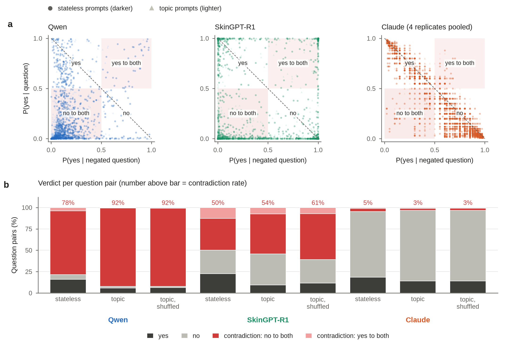
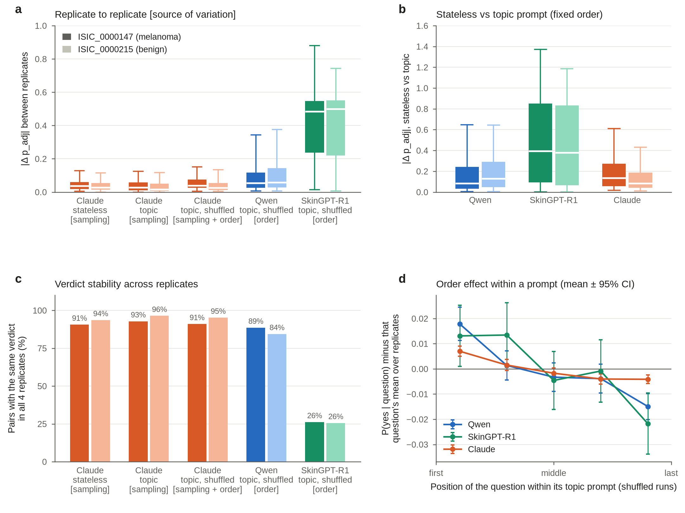
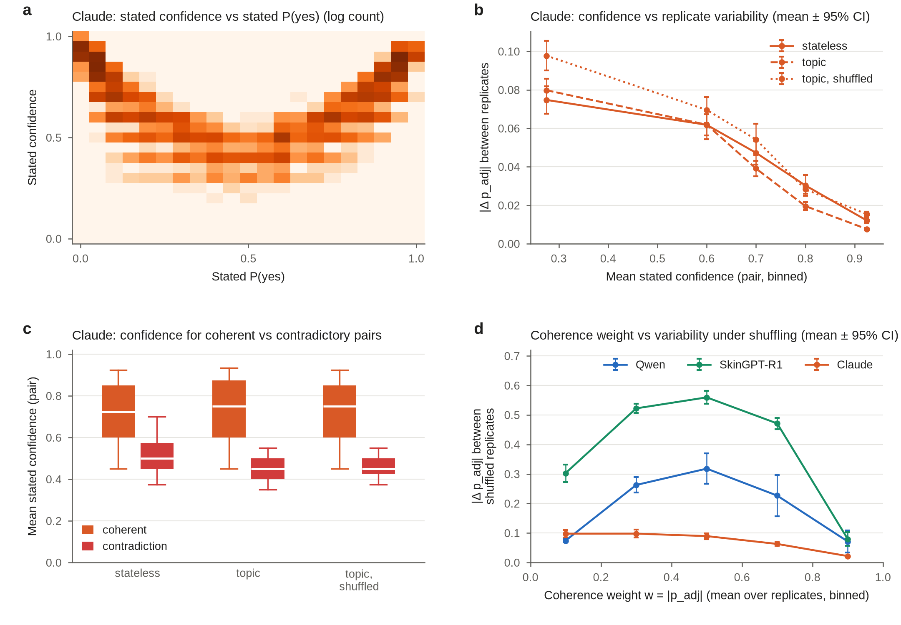
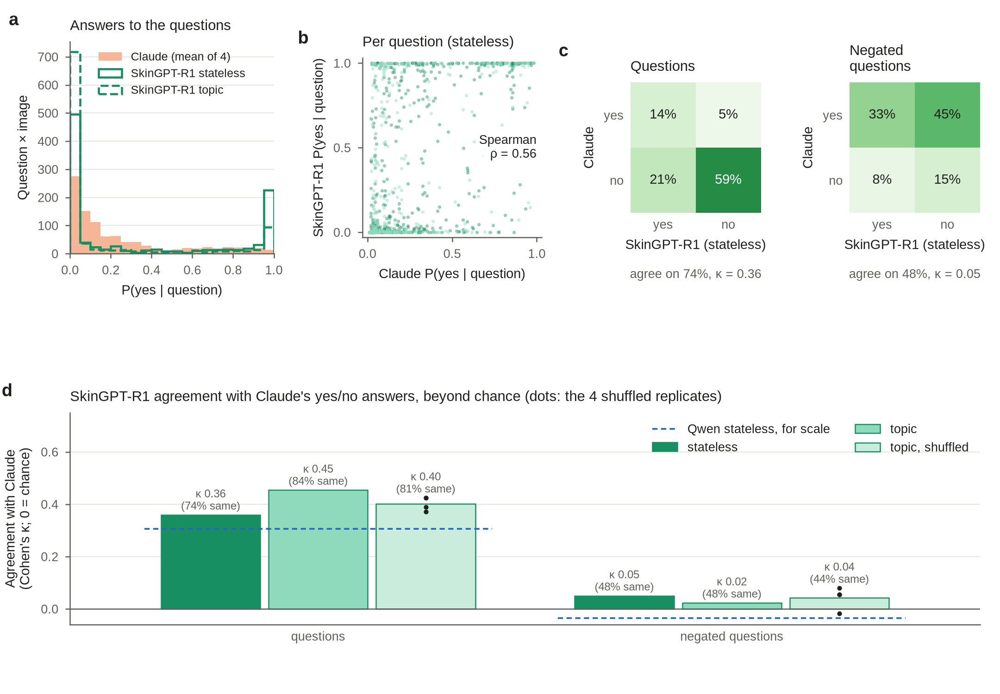
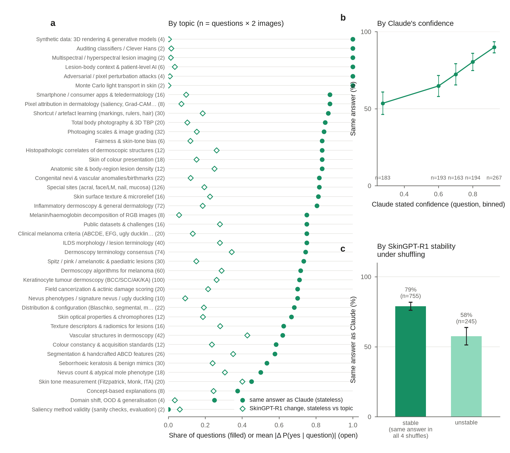

# Coherence, stability and order sensitivity of yes/no answers from three vision-language models for question-answer embeddings of dermoscopy images

QA-DermEmb pilot · 2026-10-30 · two images, 500 question pairs, three answerers

## Abstract

Question-answer embeddings represent an image by a model's answers to a fixed set of yes/no questions. Such a vector is
only useful if the answers are coherent (a question and its negation receive opposite answers) and stable (the same
question gets the same answer when asked again). We tested both properties on two dermoscopy images (ISIC_0000147,
melanoma; ISIC_0000215, benign) with 500 questions, each asked as written (Q) and negated (¬Q). The answerers were
Qwen2.5-VL-7B, SkinGPT-R1 (a dermatology fine-tune of Qwen2.5-VL-7B) and Claude Opus 5.5. We varied how questions were
asked: one per prompt (stateless), grouped by topic, or grouped by topic in a different random order per replicate.
Claude contradicted itself on 3–5% of question pairs; Qwen did so on 78–92% and SkinGPT-R1 on 50–61%.
Claude's answers were stable across replicates: the same verdict came back in all four for 91–96% of pairs. For
SkinGPT-R1, changing only the question order left the verdict unchanged for 26% of pairs. Claude's stated confidence tracked its
own stability (Spearman ρ = −0.72 to −0.79). Taking Claude as a reference, SkinGPT-R1's answers to the questions agreed
beyond chance (Cohen's κ = 0.36–0.45), but its answers to the negations did not (κ ≈ 0.05). This suggests that its
incoherence comes mostly from handling negation, not from misreading the image.

## Introduction

In question-answer embedding (QA-Emb), each image is described by a model's probability of answering "yes" to each of a
fixed set of interpretable questions. To separate what the model sees from its tendency to agree, each question is also
asked in negated form. Three quantities are derived for each question pair:

- **net yes**, p_adj = P(yes | Q) − P(yes | ¬Q), from −1 to 1;
- **coherence weight**, w = |p_adj|, from 0 to 1. It is 0 when the model gives the same answer to Q and ¬Q, and 1 when it
  answers them with certainty and opposite. It is also 0 when both answers are 0.5, so it combines consistency and decisiveness;
- **coherence-weighted P(yes)**, P_w = P(yes | Q) × w, the feature used downstream.

Before scaling to the full image set we asked four questions on a small, fully replicated sample:
1. How often does each model contradict itself?
2. How much do answers vary between replicates, and is that variation due to sampling or to question order?
3. Does Claude's stated confidence tell us anything?
4. Where do the dermatology model (SkinGPT-R1) and the most coherent model (Claude) agree?

## Methods

**Images and questions.** The images were ISIC_0000147 (melanoma) and ISIC_0000215 (benign); experiment `D0_poc2`, whole image only (`G1`). The questions were 500
yes/no questions in 41 topics, each paired with an automatically negated complement (`Q0_all`; 1,000 items per image).

**Answerers.**
- *Qwen2.5-VL-7B-Instruct* (`ANS_qwen7b`) and *SkinGPT-R1* (`ANS_skingpt_r1`) ran locally. P(yes) was read from the model's
  probabilities for the words "Yes" and "No" at the answer position. SkinGPT-R1's reasoning step was skipped by starting its
  reply after an empty reasoning block. Because P(yes) is read directly rather than sampled, these models give identical
  output for identical prompts.
- *Claude Opus 5.5* (`ANS_claude_opus_cli`, through `claude -p`, effort low) returned its P(yes) and a confidence in [0, 1]
  for each question as JSON. Each reply had to contain exactly one answer per question. Claude's API does not expose word
  probabilities, so these are *stated* values. Claude produces text by sampling, so identical prompts can give different answers.

**Prompt conditions.**
- *Stateless* (`M_stateless`): one question per prompt.
- *Topic* (`M_topic`): one prompt per topic, listing that topic's questions in a fixed order (2–63 questions). Questions and
  negations go in separate prompts.
- *Topic, shuffled* (`M_topic_shuf`): as topic, but with the question order randomly permuted within each prompt. The
  permutation differs per replicate (`R1`–`R4`) and is identical across the three models.

Claude was run in all three conditions with four replicates each. The local models were run once in stateless and topic
mode (repeats would be identical) and four times in the shuffled condition. In total there were 24 runs (Supplementary Table S1).

**Measures.**
- *Verdict* for a pair: *yes* (P(yes | Q) ≥ 0.5, P(yes | ¬Q) < 0.5), *no* (the reverse), or a contradiction (*no to both*
  or *yes to both*).
- *Variability* between two runs: |Δ p_adj| for each image × question, averaged over all pairs of runs. Claude conditions are compared
  run by run, never as replicate means.
- *Verdict stability*: the share of pairs whose verdict is identical in all four replicates.
- *Order effect beyond sampling* (Claude): the mean |Δ p_adj| between the averages of two fixed-order replicates and of two other
  fixed-order replicates (sampling alone), compared with the same between two fixed-order and two shuffled replicates
  (sampling plus order).
- *Agreement with Claude*: the reference is Claude's stateless answers, averaged over its four replicates. Agreement is the
  share of identical yes/no answers (threshold 0.5), computed separately for Q and ¬Q, and Cohen's κ. Both
  models mostly answer "no", so κ corrects for the agreement expected by chance.

Uncertainty is shown as 95% confidence intervals (1.96 × standard error). With two images, all statistics describe these
two images and do not generalise across lesions.

## Results

**Claude is coherent; the local models are not (Fig. 1, Table 1).** Claude's answers to Q and ¬Q lie close to the
anti-diagonal, where the answers to the two are complementary. Only 3.4–4.9% of its pairs were contradictions, and
switching from stateless to topic prompts did not raise that. Qwen answered "no" to both the question and its negation for most pairs: 78% contradictions with stateless prompts, rising to 92% with topic prompts, where its
mean coherence weight halved (0.21 → 0.10). SkinGPT-R1 contradicted itself on 50% (stateless), 54% (topic) and 61%
(shuffled) of pairs. It also answered "yes" to both more often than the other models (13% stateless).

**Figure 1 | Coherence of answers to a question and its negation.** **a**, P(yes | Q) against P(yes | ¬Q) for each
image × question; darker circles, stateless prompts; lighter triangles, topic prompts; Claude's four replicates are
pooled. Shaded squares are contradictions; the dashed line is perfect complementarity. **b**, Share of verdicts for
each model and prompt condition. The number above each bar is the contradiction rate; the shuffled condition pools
four replicates.

**Variability: SkinGPT-R1 is highly sensitive to question order; Claude is not (Fig. 2).** Rerunning Claude with
identical prompts changed p_adj by 0.034–0.047 on average, and 91–96% of pairs kept the same verdict in all four
replicates (Fig. 2a,c). Shuffling the order hardly changed this (0.042–0.057; 91–95%). Comparing averages of replicates
isolates order from sampling: two fixed-order averages differed by 0.028, a fixed-order and a shuffled average by 0.046.
So question order adds a small effect on top of Claude's sampling noise. For the deterministic models, order is the only
source of variation. Qwen moved by 0.09–0.11 and kept 84–89% of verdicts. SkinGPT-R1 moved by 0.41–0.42 and kept only 26%. Switching from
stateless to topic prompts shifted SkinGPT-R1 by 0.48–0.50, against 0.14–0.20 for Claude and 0.17–0.20 for Qwen
(Fig. 2b). The two images behaved alike throughout. Within a topic prompt, questions placed first received slightly higher
P(yes | Q) than those placed last. The difference was 0.033–0.035 for the local models and 0.011 for Claude (Fig. 2d). It is
small next to the other effects, but it does count in favour of stateless prompting.

**Figure 2 | Variability of answers.** **a**, |Δ p_adj| between replicates for each question ID, labelled with the source of
variation: sampling (Claude, fixed prompts), order (local models, shuffled prompts), or both (Claude, shuffled). Darker
box, ISIC_0000147; lighter, ISIC_0000215. Box, interquartile range; white line, median; whiskers, 5th–95th percentile.
**b**, |Δ p_adj| between stateless and topic prompts; for Claude, the average over all 16 cross-replicate pairs.
**c**, Share of question pairs with the same verdict in all four replicates. **d**, P(yes | Q) relative to that
question's mean over the four shuffled replicates, by relative position within its topic prompt (five bins; mean ± 95% CI).

**Claude's stated confidence is informative (Fig. 3).** Claude's stated confidence tracked how extreme its stated P(yes)
was (r = 0.90 with |P(yes) − 0.5|; Fig. 3a). It was also inversely related to its own replicate variability (Spearman
ρ = −0.72 stateless, −0.79 topic, −0.74 shuffled; Fig. 3b). Pairs that Claude contradicted had a median confidence of 0.45–0.50,
against 0.73–0.75 for coherent pairs (Fig. 3c). For Claude, a higher coherence weight also meant lower variability under
shuffling (ρ = −0.76). For the local models the relation was positive (Qwen ρ = 0.69, SkinGPT-R1 ρ = 0.25; Fig. 3d).
Their least variable pairs are those they reject with both answers at 0, so w ≈ 0: consistently incoherent rather than
coherent and stable.

**Figure 3 | Confidence.** **a**, Claude's stated confidence against its stated P(yes), all answers pooled (log
count). **b**, Mean |Δ p_adj| between Claude replicates by the pair's mean stated confidence (five bins; mean ± 95%
CI), per condition. **c**, Mean stated confidence of coherent and contradictory pairs. **d**, |Δ p_adj| between shuffled
replicates against the coherence weight w (mean over replicates, five bins).

**SkinGPT-R1 agrees with Claude on the questions but not on the negations (Fig. 4).** SkinGPT-R1's answers were mostly
all-or-nothing: 72% (stateless) and 81% (topic) of its P(yes | Q) values were below 0.05 or above 0.95, against 29% for
Claude (Fig. 4a). This explains its low stability. A small change of context flips a saturated answer from 0 to 1,
which counts as a full verdict change. Its answers to the questions ranked similarly to Claude's (Spearman ρ = 0.56; Fig. 4b) and
agreed beyond chance: 74% identical, κ = 0.36 (stateless); 84%, κ = 0.45 (topic); 81%, κ = 0.37–0.42 (shuffled
replicates; Fig. 4c,d). Its answers to the negations agreed with Claude's no better than chance (44–48% identical,
κ = −0.02 to 0.08; ρ = 0.16). Claude answered "yes" to 78% of negated questions (for example, "Does the lesion lack …?")
and SkinGPT-R1 answered "no" to most of those. The coherence-weighted feature P_w inherits this failure: its correlation with Claude's
P_w (ρ = 0.38) is lower than for P(yes | Q) alone. Qwen, for scale, reached κ = 0.31 on the questions, mostly by
answering "no", and κ = −0.04 on the negations.

**Figure 4 | SkinGPT-R1 compared with Claude.** The Claude reference is its stateless answers, averaged over four replicates. **a**,
Distribution of P(yes | Q). **b**, P(yes | Q) per image × question (stateless; darker, ISIC_0000147; lighter,
ISIC_0000215). **c**, Yes/no cross-tabulation (threshold 0.5) for the questions and for the negated questions, as
percentages of all 1,000 answers, with raw agreement and Cohen's κ. **d**, Cohen's κ (0 = chance) by prompt condition;
dots, the four shuffled replicates; dashed line, Qwen stateless.

**Where they agree (Fig. 5).** On the questions, agreement rose steadily with Claude's stated confidence, from 54% to
90% (Fig. 5b). It was also higher for questions SkinGPT-R1 answered the same way in all four shuffles: 79% (n = 755), against
58% (n = 245; Fig. 5c). By topic it ranged from about 85% (photoaging grading, shortcut/artefact learning,
teledermatology, total-body photography) to 45–55% (skin-tone measurement, nevus count, seborrhoeic keratosis and benign
mimics). Topics where SkinGPT-R1 agreed less with Claude were also those where its answers moved more between stateless and topic
prompts (Spearman ρ = −0.58 across topics; Fig. 5a). The topics at 0% or 100% contain only 2–4 answers each.

**Figure 5 | Where SkinGPT-R1 agrees with Claude on the questions.** **a**, By topic: share of identical yes/no answers
to Q (filled; stateless) and SkinGPT-R1's mean |Δ P(yes | Q)| between stateless and topic prompts (open). Numbers in
parentheses, questions × 2 images. **b**, Agreement by Claude's stated confidence for Q (five bins; mean ± 95% CI;
n per bin). **c**, Agreement for questions SkinGPT-R1 answered stably or unstably across the four shuffled
replicates (mean ± 95% CI).

## Discussion

For QA-Emb, these two images point to three practical conclusions.
- **Claude's answers already behave like usable features.** They are coherent, reproducible to a few hundredths, and
  little affected by how they are grouped. Topic prompts match stateless ones closely (|Δ p_adj| 0.14–0.20, 91% identical
  verdicts in our earlier comparison) at about one-ninth of the tokens. This makes topic prompting the economical
  choice for scaling Claude. Claude's stated confidence identifies its own unstable and contradictory answers, so it could
  serve as a per-answer weight.
- **For the local models, stateless prompting is necessary but not sufficient.** Grouping questions raised their
  contradictions and introduced order effects. Qwen's answers are dominated by a "no" bias.
- **SkinGPT-R1 carries information in its answers to the questions, not to the negations.** Its incoherence and instability arise
  from saturated answers and a failure to process negated phrasing. Weighting its answers by coherence (P_w) penalises
  the negation failure instead of the image content. For this model, P(yes | Q) alone, or negations rewritten as
  affirmative opposites, may be the better input.

**Limitations.**
- **Sample size.** Two images and one lesion each of melanoma and benign: per-question estimates are noisy, and per-topic
  estimates rest on 2–126 answers.
- **Claude is a reference, not ground truth.** Agreement with Claude measures consistency with a coherent model, not
  correctness.
- **Different quantities.** Claude's values are stated probabilities, whereas the local models' values are word
  probabilities. The two are not on the same scale, which is one reason agreement is measured on yes/no answers and
  ranks.
- **Negations.** These were generated automatically and some may be awkward; part of SkinGPT-R1's negation failure may be
  phrasing.

## Data and code availability

- **Figures:** produced by [make_figures.py](make_figures.py) (`poetry run python reports/2026-10-30_claude_poc/make_figures.py`).
  Vector versions are in [figures/](figures/).
- **Every number quoted:** in [numbers.json](numbers.json).
- **Table 1:** [table1.csv](table1.csv).
- **Per-question data:** [compare/compare_answers.csv](compare/compare_answers.csv) and the replicate folders; see [README.md](README.md).

**Table 1 | Summary by answerer and prompt condition** (both images, 1,000 question pairs per run). Pooled over the runs in
each condition. Replicate columns are empty where only one run exists. Confidence is stated by Claude only.

| Answerer | Condition | Runs | Verdict yes (%) | Contradiction (%) | No to both (%) | Yes to both (%) | Mean coherence weight w | Replicate \|Δ p_adj\| | Same verdict in all replicates (%) | Mean stated confidence |
|---|---|---|---|---|---|---|---|---|---|---|
| Qwen | stateless | 1 | 15.9 | 78.4 | 74.6 | 3.8 | 0.21 | – | – | – |
| Qwen | topic | 1 | 5.8 | 92.2 | 91.7 | 0.5 | 0.10 | – | – | – |
| Qwen | topic, shuffled | 4 | 6.3 | 92.2 | 91.2 | 1.0 | 0.11 | 0.10 | 86.5 | – |
| SkinGPT-R1 | stateless | 1 | 22.5 | 49.8 | 37.0 | 12.8 | 0.50 | – | – | – |
| SkinGPT-R1 | topic | 1 | 9.4 | 54.3 | 46.8 | 7.5 | 0.46 | – | – | – |
| SkinGPT-R1 | topic, shuffled | 4 | 11.6 | 60.8 | 53.6 | 7.2 | 0.39 | 0.42 | 25.9 | – |
| Claude | stateless | 4 | 18.5 | 4.9 | 3.6 | 1.3 | 0.64 | 0.044 | 92.1 | 0.71 |
| Claude | topic | 4 | 14.1 | 3.5 | 2.3 | 1.2 | 0.72 | 0.038 | 94.6 | 0.72 |
| Claude | topic, shuffled | 4 | 14.0 | 3.4 | 2.4 | 1.0 | 0.72 | 0.049 | 93.1 | 0.72 |

**Supplementary Table S1 | Runs.** All runs use images `D0_poc2` (or `D0_smoke10`, restricted to these two images),
questions `Q0_all` and whole image `G1`. Prompt templates are identified by name and content hash.

| Answerer | Condition | Run IDs | Prompt |
|---|---|---|---|
| Qwen2.5-VL-7B (`ANS_qwen7b`) | stateless (`M_stateless`) | `20261029-152402_answerers-oct29` | `stateless_whole_v1` (d5f97baafa00) |
| Qwen2.5-VL-7B | topic (`M_topic`) | `20261029-152411_answerers-oct29` | `batched_whole_v1` (eb9237156b9f) |
| Qwen2.5-VL-7B | topic, shuffled (`M_topic_shuf`), `R1`–`R4` | `20261030-135524`, `-135855`, `-140216`, `-140536` (`_local-shuffle`) | `batched_whole_v1` (eb9237156b9f) |
| SkinGPT-R1 (`ANS_skingpt_r1`) | stateless | `20261029-152430_answerers-oct29` | `stateless_whole_v1` (d5f97baafa00) |
| SkinGPT-R1 | topic | `20261029-152656_answerers-oct29` | `batched_whole_v1` (eb9237156b9f) |
| SkinGPT-R1 | topic, shuffled, `R1`–`R4` | `20261030-135709`, `-140040`, `-140400`, `-140712` (`_local-shuffle`) | `batched_whole_v1` (eb9237156b9f) |
| Claude Opus 5.5 (`ANS_claude_opus_cli`) | stateless, `R1`–`R4` | `20261030-005209`, `-013448`, `-051502`, `-052021` (`_claude-cli-poc`) | `claude_stateless_whole_v1` (5ab94b38280f) |
| Claude Opus 5.5 | topic, `R1`–`R4` | `20261030-002157`, `-003848`, `-004312`, `-004738` (`_claude-cli-poc`) | `claude_batched_whole_v1` (b23c348132ac) |
| Claude Opus 5.5 | topic, shuffled, `R1`–`R4` | `20261030-141502`, `-141920`, `-142338`, `-142804` (`_claude-shuffle`) | `claude_batched_whole_v1` (b23c348132ac) |

The Qwen and SkinGPT-R1 stateless and topic runs answered the 10 `D0_smoke10` images (one per diagnostic class); only
ISIC_0000147 and ISIC_0000215 are used here.
