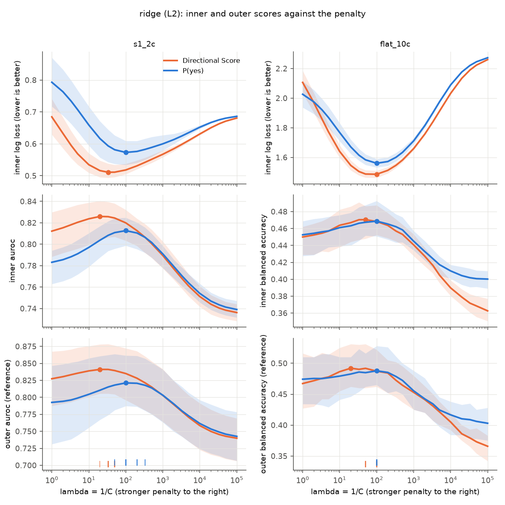
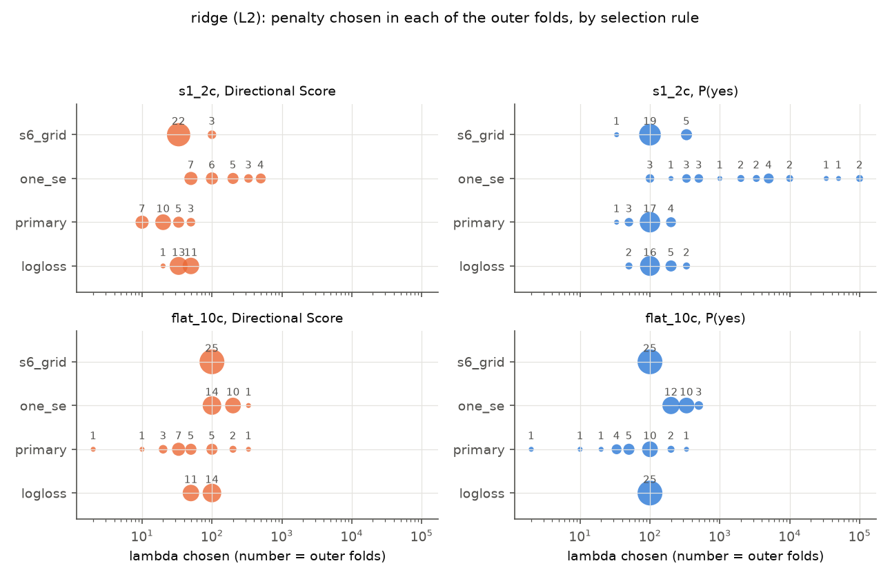
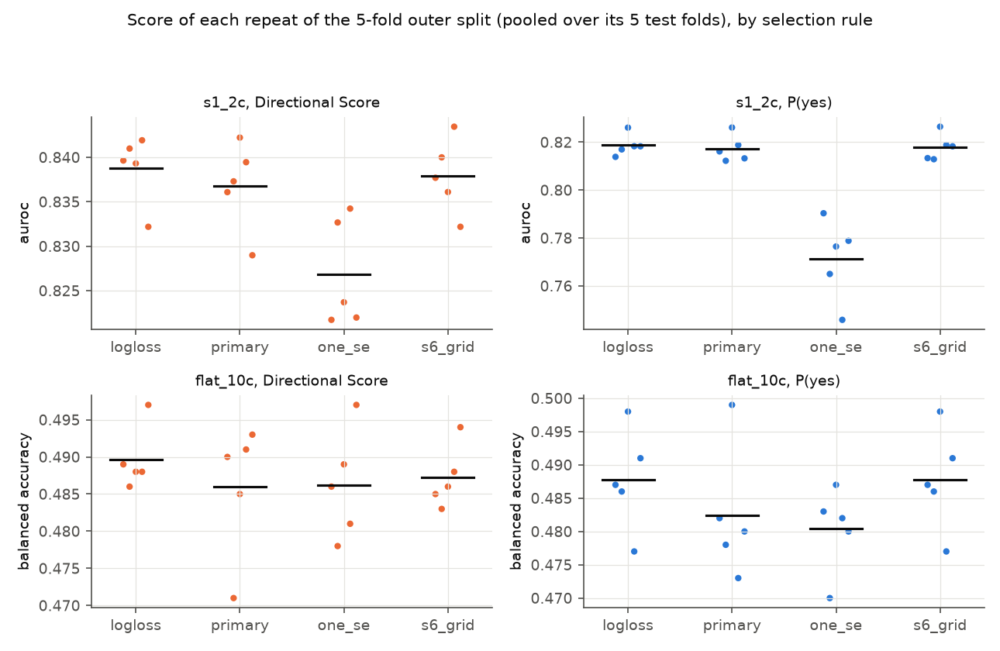

# How the ridge penalty is chosen, and how much it matters (2026-11-14)

**Question.** At the PI meeting on 2026-11-12 we were asked what the ridge penalty (lambda) is and how we choose it
(PROJECT.md, Plan item A). Three things to settle: whether S6's coarse grid of penalties costs us anything, whether
lambda should be chosen by AUROC (the main score) rather than by log loss, and whether the 5 repeats of the outer split
are worth keeping or a single 5×3 nested cross-validation would do.

## Runs covered

| Run | Experiments (meaning) | Stage hashes |
|---|---|---|
| [20261114-185921_s8-ridge-tune](../../outputs/qaemb/runs/20261114-185921_s8-ridge-tune/report.md) | `D1_train` (all 1,000 beta images), `I1_claude_max` (images shrunk only, to at most 3.6 MP), `Q0_orig` (500 questions as written plus the control question, no negations), `M_topic` (one prompt per topic), `ANS_claude_sonnet` (Claude Sonnet 5.5 through the Batch API, effort low), `G1` (whole image), `R1` (replicate 1). Stage `tune`. | embed `6cd6f95ebcbd`, classify `670746415c57`, tune `ddbcef5075bb` |

No new answers were needed and nothing was spent on the API; the stage reads the answers already embedded on
2026-11-11.

Two earlier runs of the stage the same afternoon are superseded. `20261114-185131_s8-smoke` (tune `1a7bff2db97d`)
was a small test on one score and one task. `20261114-185209_s8-ridge-tune` (tune `945ea8b4be75`) failed its check
against S6 in 6 of 100 folds; the cause is under Validity checks.

**What changed before the run.** We added a stage, S8 tune (`qaemb/stages/s8_tune.py`, run with `stage=tune`;
settings under `tune:` in `conf/base.yaml`), with its fitting code in `qaemb/models/tuning.py` and three figure
helpers in `qaemb/models/plots.py`. Nothing in S6 changed.

## What lambda is

Ridge here is logistic regression with an L2 penalty, fitted in scikit-learn. Each question's answers are first
standardised (mean 0, standard deviation 1 within the training images), so one penalty applies equally to every
question. scikit-learn minimises

C × (sum over training images of the class-weighted log loss) + ½ × (sum of squared question weights),

so lambda = 1 / C: the larger lambda, the more the weights are pulled towards zero, and the more the model leans on
many questions a little rather than a few questions a lot. Benign and malignant images are weighted so that each class
counts equally. In the per-image units some packages use (glmnet in R, for example), the penalty is lambda divided
by the number of training images: lambda 33 on 640 training images is about 0.05.

## How we ran it

The stage repeats S6's design exactly for ridge: the same 25 outer test folds (5 repeats of 5-fold, stratified on the
10 subtypes and grouped by lesion), the same 3 inner folds inside each outer training set, and the same model settings
and random seeds. It then does two things S6 does not.

- **A finer grid.** 21 values of C from 0.00001 to 1, that is lambda from 1 to 100,000, at 1, 2, 3 and 5 per decade
  (S6 searched 7 values, lambda 10 to 10,000, in steps of about 3). S6's 7 values are part of the grid.
- **Every penalty is scored, inside and outside.** For each outer fold and each penalty, the model is fitted on two
  thirds of the outer training set and scored on the remaining third, for each of the 3 inner folds (*inner* scores,
  the only numbers a selection rule sees). It is also fitted on the whole outer training set and scored on the outer
  test fold (*outer* scores, images the selection never saw). We draw the outer curve over every penalty only to show
  how peaked it is. Choosing the penalty from it would be choosing on the test images.

Four selection rules then each pick one penalty per outer fold from the inner scores, and we read off that fold's
outer score:

1. **Log loss**: the lowest mean inner log loss, as S6 does, on the fine grid.
2. **AUROC**: the highest mean inner AUROC for benign against malignant, the highest mean inner balanced accuracy for
   the 10-class task.
3. **One standard error**: the strongest penalty whose inner log loss is within one standard error of the lowest. A
   common way of preferring the simpler model when the curve is flat.
4. **S6's grid**: log loss on S6's 7 values only, which must reproduce S6 (see below).

Two tasks (benign against malignant, the flat 10-class task) and two scores (Directional Score, P(yes)), as reported
for the main model. The run took 3.5 minutes on 72 cores (8,400 fits).

## Validity checks

- **The stage reproduces S6 exactly.** With S6's 7 values and log loss, it chose the same penalty as S6 and gave the
  same outer score in all 100 outer folds (25 folds × 2 tasks × 2 scores; `s6_check.csv`). So every difference below is
  due to the grid or the rule, not to a change in the folds or the model.
- **A first run did not reproduce S6 in 6 folds, and the reason matters for how we read log loss.** In the superseded
  run `20261114-185209_s8-ridge-tune`, the inner log loss was computed with predicted probabilities floored at
  0.0000001, whereas scikit-learn's own scorer (used by S6) does not floor them. Six benign-against-malignant folds on
  P(yes) then chose a neighbouring penalty. In one inner fold we traced, a single image predicted with near-certainty
  for the wrong class changed the mean log loss of the fold's roughly 210 images by 0.01, enough to change the choice. We removed
  the floor so the stage matches S6. The lesson is that inner log loss on a few hundred images can be dominated by one
  or two confidently wrong images. This is also why the one-standard-error rule behaves erratically on P(yes) (below).

## Results

### The penalty S6 chose is close to the best, and the score is flat around it

Figure: [penalty_curves.png](figures/penalty_curves.png). Columns: benign against malignant (left), 10-class (right).
Rows: inner log loss, inner AUROC or balanced accuracy, outer AUROC or balanced accuracy (reference only). The line is
the mean over the 25 outer folds, the band the 10th to 90th percentile over folds. The dot marks each curve's best
value. The ticks on the bottom row are the penalties S6's rule chose, one row of ticks per score.

| Score, task | lambda at lowest inner log loss | lambda at best outer score (reference) | outer score: at best / at 10 times weaker / at 10 times stronger penalty |
|---|---|---|---|
| Directional Score, benign vs malignant | 33 | 20 | AUROC 0.841 / 0.830 / 0.828 |
| P(yes), benign vs malignant | 100 | 100 | AUROC 0.821 / 0.804 / 0.803 |
| Directional Score, 10-class | 100 | 20 | balanced accuracy 0.492 / 0.472 / 0.484 |
| P(yes), 10-class | 100 | 100 | balanced accuracy 0.488 / 0.479 / 0.455 |

- The curves have one broad optimum, well inside the grid: lambda between about 20 and 100. Within a factor of 3 of
  the optimum, outer AUROC moves by less than 0.01; a factor of 10 either way costs about 0.01 to 0.02.
- The best penalty on the outer folds (which we may not use to choose) gives an AUROC only 0.001 higher than what the
  nested selection actually achieves (0.841 against 0.840 for the Directional Score). So choosing lambda inside the
  folds costs almost nothing, and the reported score is not inflated by the choice either.
- P(yes) needs a stronger penalty than the Directional Score (lambda 100 against 33). Its AUROC falls off faster when
  the penalty is weak (0.79 at lambda 1, against 0.83 for the Directional Score), which fits P(yes) having many
  answers bunched near 0 whose small differences a weakly penalised model over-reads.
- With a very strong penalty all weights shrink towards zero, and AUROC falls to 0.76 at lambda 10,000 and 0.74 at
  100,000. It stays well above chance because the shrunken weights keep their direction: in the limit each question's
  weight is proportional to the difference between its mean answer in malignant and in benign images, so the model
  becomes a simple signed sum of the standardised answers.

### Choosing by AUROC instead of log loss gains nothing

| Score, task | Rule | Outer score, mean ± sd over 25 folds | Specificity at 95% sensitivity | lambda chosen: median (range) |
|---|---|---|---|---|
| Directional Score, benign vs malignant | log loss, fine grid | AUROC 0.840 ± 0.030 | 0.44 | 33 (20 to 50) |
| | AUROC, fine grid | 0.839 ± 0.031 | 0.43 | 20 (10 to 50) |
| | one standard error | 0.829 ± 0.030 | 0.43 | 100 (50 to 500) |
| | log loss, S6's grid (= S6) | 0.839 ± 0.030 | 0.44 | 33 (33 to 100) |
| P(yes), benign vs malignant | log loss, fine grid | 0.820 ± 0.034 | 0.45 | 100 (50 to 333) |
| | AUROC, fine grid | 0.819 ± 0.034 | 0.44 | 100 (33 to 200) |
| | one standard error | 0.785 ± 0.043 | 0.37 | 2,000 (100 to 100,000) |
| | log loss, S6's grid (= S6) | 0.819 ± 0.034 | 0.44 | 100 (33 to 333) |
| Directional Score, 10-class | log loss, fine grid | balanced accuracy 0.490 ± 0.026 | | 100 (50 to 100) |
| | balanced accuracy, fine grid | 0.486 ± 0.025 | | 50 (2 to 333) |
| | one standard error | 0.486 ± 0.027 | | 100 (100 to 333) |
| | log loss, S6's grid (= S6) | 0.487 ± 0.026 | | 100 (100 to 100) |
| P(yes), 10-class | log loss, fine grid | 0.488 ± 0.025 | | 100 (100 to 100) |
| | balanced accuracy, fine grid | 0.482 ± 0.029 | | 100 (2 to 333) |
| | one standard error | 0.480 ± 0.025 | | 333 (200 to 500) |
| | log loss, S6's grid (= S6) | 0.488 ± 0.025 | | 100 (100 to 100) |

Full table with more columns: `rules_summary.csv`. Figure: [chosen_lambda.png](figures/chosen_lambda.png), how many
of the 25 folds chose each penalty under each rule.

- **The finer grid changes almost nothing.** AUROC 0.840 against 0.839 on the Directional Score, and the same within
  0.003 elsewhere. The fold-to-fold standard deviation is 0.03, ten times larger.
- **Choosing by AUROC is no better and less stable.** It gives the same or slightly lower scores on every task and
  score, and it scatters the chosen penalty more widely. On the 10-class task, choosing by balanced accuracy picked
  values from lambda 2 to 333. AUROC and balanced accuracy on an inner fold of about 210 (benign against malignant) to 270 (10-class) images change in steps
  (a few images swapping order or class), so they are noisier guides than log loss, which uses every probability.
  This is the usual reason to tune on log loss even when the reported score is AUROC.
- **The one-standard-error rule costs accuracy.** With only 3 inner folds the standard error is itself poorly
  estimated, and on P(yes) one confidently wrong image (Validity checks) can widen it enough for the rule to run to the
  edge of the grid (lambda 100,000 in 2 folds). AUROC 0.785 against 0.820.

### The 5 repeats: what a single 5×3 nested CV would give

Each repeat of the outer 5-fold split puts every image in a test fold exactly once, so each repeat on its own is one
complete 5×3 nested cross-validation. Figure: [repeat_spread.png](figures/repeat_spread.png), the score of each repeat
(its 5 test folds pooled) by rule.

With S6's rule on the Directional Score, the 5 repeats gave AUROC 0.832, 0.839, 0.840, 0.841 and 0.842 for benign
against malignant, and balanced accuracy 0.486 to 0.497 for the 10-class task. A single 5×3 nested CV would therefore
have reported any value in a band about 0.01 wide, depending only on how the images happened to be shuffled into
folds. The mean over 5 repeats is steadier than any one of them, though by less than a factor of √5, since the repeats reuse the same images. For ridge the repeats cost little (the whole
stage, 8,400 fits, took 3.5 minutes; S6 with all six model families takes about 40 minutes), so we see no reason to
drop them. The fold-to-fold standard deviation (0.03) is larger than the spread between repeats because each fold has
only about 160 images.

## What this means

- **The answer for the PI.** Lambda is the strength of the L2 penalty on the standardised question weights, lambda =
  1 / C in scikit-learn. It is chosen inside each outer training set by 3-fold cross-validation on log loss, and for
  the main model (Directional Score, benign against malignant) it comes out at about 33 in most folds (20 to 50 on the
  fine grid). Performance is flat for lambda between about 20 and 100, so the exact value hardly matters, and the
  nested choice gives up only 0.001 AUROC against the best value in hindsight.
- **Keep log loss for choosing lambda,** and keep reporting AUROC and specificity at 95% sensitivity. Choosing by AUROC
  gained nothing and was less stable.
- **The fine grid is worth adopting at the next S6 rerun** (for example the lesion-only rerun, Plan item 4), mainly so
  that the chosen value can be stated more precisely. It will not change the reported scores; we do not rerun S6 for
  it alone.
- **Keep the 5 repeats.** A single 5×3 nested CV would vary by about 0.01 AUROC with the shuffle, at little saving.
- **Reported performance for the main model stays as in S6:** AUROC 0.84 ± 0.03 over the 25 outer folds, specificity
  0.44 at 95% sensitivity; balanced accuracy 0.49 on the 10-class task. The final model, refitted on all 1,000 images
  with lambda chosen on them, is not scored on them; it will be scored once on the external test set.

## Limitations

- Ridge only. The lasso and elastic net have their own grids in S6, which this stage can also run (`tune.model=l1`);
  we did not, since ridge is the main model.
- The penalty is chosen on inner training sets of about 430 images (two thirds of 640) and then applied, unchanged,
  to the full outer training set of 640. In scikit-learn's parametrisation the same C on more images is a relatively
  weaker penalty per image. This is how S6 and scikit-learn's grid search work; the flat curves suggest it does not
  matter here.
- One replicate of Sonnet's answers. The spread between repeats is the spread from splitting the images, not from
  re-asking Sonnet.

## Files

- `rules_summary.csv`: per score, task and rule, the outer score (mean and standard deviation over folds, pooled per
  repeat), secondary scores, and the penalties chosen.
- `repeats.csv`: the pooled score of each repeat, per rule.
- `s6_check.csv`: S6's chosen penalty and outer score against this stage's, fold by fold.
- `tune_summary.md`: the summary the stage writes.
- In the stage folder (`outputs/qaemb/tune/ddbcef5075bb/`, not in git): `inner_curves.csv` (every inner fold at every
  penalty), `fold_curves.csv` (per outer fold and penalty, inner means and the outer scores), `selections.csv`,
  `oof_predictions.parquet`.
