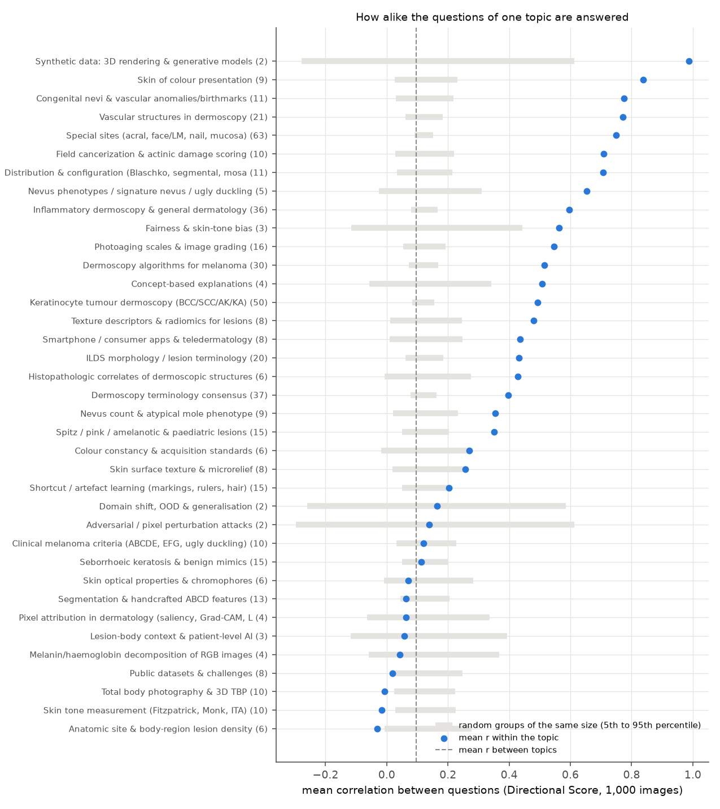
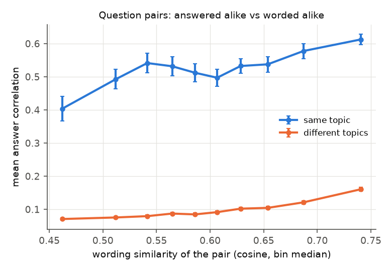
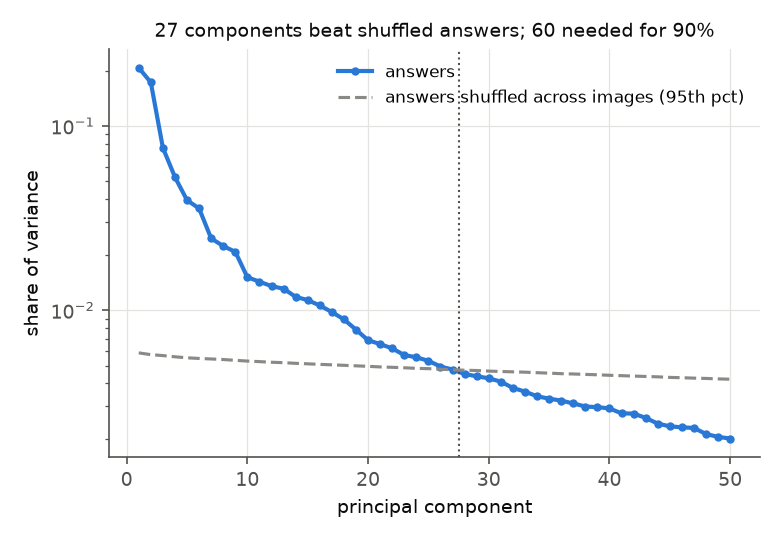
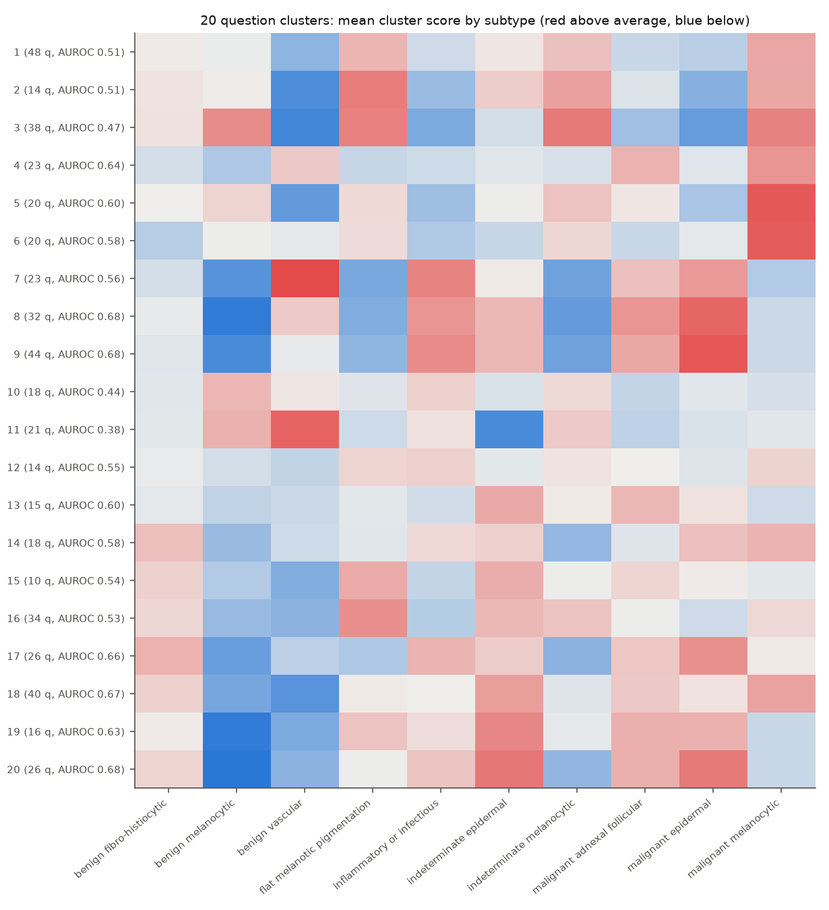
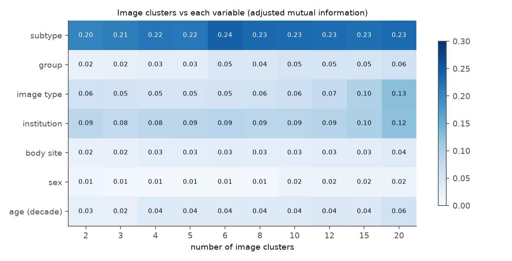

# Structure of Sonnet's answers: questions, images and metadata (2026-11-15)

**Question.** Before asking what the answers predict, what structure do they have on their own (PROJECT.md, Plan item
B, the answers part)? Which questions are answered alike, and is that because they describe related features, because
they are worded alike, or because they were asked in the same prompt (the first half of Plan item D)? How many
independent dimensions do the 500 questions amount to? And when the images are grouped by their answers, do the groups
follow the diagnosis, or the image type, the institution or the patient?

**Interactive version.** [explorer.html](explorer.html) (about 6 MB, self-contained; open it in any browser, no internet
needed). Last rebuilt on 2026-11-16 (explore `d374126c546a`, run `20261116-182605_s9-explore-metrics`) with tabs: an
overview (abstract, a flow diagram of the analysis whose boxes open the chapters, and one line per principal result),
then eleven chapters:
1. the answer matrix;
2. topic coherence (whether questions in a topic are answered alike);
3. dimensionality of the questions;
4. what the images' answer profiles follow;
5. classification, from the S10 ridge run;
6. question importance, from the S7 importance run;
7. the ten subtypes in detail, from the S11 subtypes run;
8. naevus against melanoma, from the S11 subtypes run;
9. model metrics: sensitivity, specificity, accuracy and F1 for every model and task, at a stated threshold;
10. case studies: how the prediction for one melanoma and one naevus is built, question by question;
11. methods and limitations.

Each chapter opens with its principal result, then numbered figures with captions and an interpretation. The heavier
interactive tools (correlation matrix, question map, image clusters, full heatmap) sit in expandable panels inside the
chapter they belong to. Selecting a question anywhere opens it on the question map, and selecting an image opens its
panel. The page is light only, set in EB Garamond (SIL Open Font License, embedded from `qaemb/templates/fonts/`), with
charts and tables in a plain sans. An intermediate build on 2026-11-15 (explore `3c3bb1a3d4d0`) used a blackletter
face for the title, chapter names and drop cap; it was replaced by Garamond as hard to read. The data are identical to the earlier narrative
build (explore `a35b9e7a2913`).

The rebuild of 2026-11-16 (`20261116-134236_s9-explore-coefdir`) changed only the importance chapter. Fig. 6.1 gained a
second view, "By direction", which lists the same twenty questions in two columns, toward malignant and toward benign,
ordered by ridge weight, in the layout of Fig. 6.3. Each entry also shows its weight in the 27-question lasso model, or
that the lasso dropped it. Fig. 6.3 in turn shows each question's consensus rank among the 446. Read together, 15 of the
top 20 are kept by the lasso, every shared question points the same way in both models, and the lasso's strongest
benign question ("bluish-purple, suggesting low blood oxygen saturation", rank 5) and malignant question (chronic sun
damage, rank 3) are near the top of the consensus ranking. To support this the stage now passes the consensus rank
and ridge weight of every question to the page.

The rebuild later the same day (`20261116-151909_s9-explore-cases`) added chapter VII, case studies. It shows two images,
a melanoma (ISIC_2742711) and a naevus (ISIC_0029550), chosen automatically as dermoscopic, correctly classified out of
fold, and the most typical of their subtype (out-of-fold probability closest to the subtype median; other images can be
named in `explore.case_images`). For each, the main ridge model is refitted with the same penalty on every labelled
image except that patient's, and its prediction is traced as a path: it starts from the average image (P(malignant)
0.40), then each question adds its weight times how far this image's answer lies from the average, and the steps sum
exactly to the prediction. The eight largest steps are shown with Claude's answer and the question's weight; the other
438 are summed. The melanoma ends at 0.71 and the naevus at 0.13. In the melanoma, most of the largest steps are
less certain "no" answers to questions that do not apply to it (for example an acral site on dark skin), rather than
melanoma features; this is the same reliance on the confidence of negative answers noted in Ch. VI.

The third rebuild that day (`20261116-174534_s9-explore-subtypes`, explore `f21e0ac0a1d6`) added two chapters from the new
S11 subtypes stage, at the request of our collaborating dermatologist; the case studies became chapter IX and the methods
chapter X, and the case-study figures were renumbered 9.x. Chapter VII, Ten Subtypes, shows per-subtype sensitivity,
precision, F1 and one-against-rest AUROC with their range over repeats, the confusion matrix (moved from chapter V,
where Fig. 5.4 is now the questionnaire-size figure and Fig. 5.5 points to the two new chapters) and the nature of the
errors. Chapter VIII, Naevus and Melanoma, compares four scores on the 100 naevi and 100 melanomas (ROC, a table with
bootstrap intervals and paired differences), plots the pair-model score of every naevus, melanoma and atypical
melanocytic lesion by histopathological diagnosis, breaks AUROC down by melanoma type and naevus confirmation, and lists
the questions that separate the two classes. The numbers are in [the S11 report](../2026-11-16_naevus_melanoma_subtypes/README.md).

The last rebuild that day (`20261116-182605_s9-explore-metrics`, explore `d374126c546a`, reading subtypes `b88b736bdec8`)
added chapter IX, Model Metrics. It shows sensitivity, specificity, accuracy and F1 (with precision and AUROC) for:
- benign against malignant: ridge on all questions, ridge on the lasso-chosen 120, 60 and 27, and the direct question;
- naevus against melanoma: the four scores of chapter VIII.
These can be shown at P ≥ 0.5 or at the threshold that catches 95% of positive cases, on all or dermoscopic images.
For the ten subtypes it shows per-subtype sensitivity, specificity, precision and F1. There are definitions of each
measure and a CSV download of the table shown. Case studies became chapter X (figures 10.x) and methods chapter XI.

## Runs covered

| Run | Experiments (meaning) | Stage hashes |
|---|---|---|
| [20261115-105528_s9-explore](../../outputs/qaemb/runs/20261115-105528_s9-explore/report.md); page rebuilt in [20261116-010945_s9-explore-garamond](../../outputs/qaemb/runs/20261116-010945_s9-explore-garamond/report.md) (explore `5e1e8b163035`) [20261116-134236_s9-explore-coefdir](../../outputs/qaemb/runs/20261116-134236_s9-explore-coefdir/report.md) (explore `4e20b9e8faf3`) [20261116-151909_s9-explore-cases](../../outputs/qaemb/runs/20261116-151909_s9-explore-cases/report.md) (explore `a29d7e4fe69b`), [20261116-174534_s9-explore-subtypes](../../outputs/qaemb/runs/20261116-174534_s9-explore-subtypes/report.md) (explore `f21e0ac0a1d6`) and [20261116-182605_s9-explore-metrics](../../outputs/qaemb/runs/20261116-182605_s9-explore-metrics/report.md) (explore `d374126c546a`, reading also ridge `159decea7f3d`, importance `43a20169f0c0` and subtypes `b88b736bdec8`) | `D1_train` (all 1,000 beta images), `I1_claude_max` (images shrunk only, to at most 3.6 MP), `Q0_orig` (500 questions as written plus the control question, no negations), `M_topic` (one prompt per topic), `ANS_claude_sonnet` (Claude Sonnet 5.5 through the Batch API, effort low), `G1` (whole image), `R1` (replicate 1). Stage `explore`. | embed `6cd6f95ebcbd`, classify `670746415c57`, importance `43a20169f0c0`, explore `e0f6b40a7715` |

Three earlier runs the same morning are superseded: `20261115-104059_s9-dev` (explore `04b4417cca54`; average-linkage
clustering and a placeholder page) and two runs of `s9-explore` (explore `91c40697ad8d`; the page had a start-up bug
and an unreadable question map). The statistics other than the question clusters are the same in all of them.

No API calls were made. The stage reads the answers already embedded on 2026-11-11.

**What changed before the run.**
- **ISIC metadata.** A new script, `python -m qaemb.isic_metadata <manifest>`, fetched the public ISIC Archive record
  of each of the 1,000 images. Only the public image IDs were sent. The results are in
  `data/train_10class_100each/isic_metadata.csv`, with the raw records kept next to it. This also does the metadata part
  of Plan item 2.
- **Question-text embeddings.** A new script, `analysis/question_embeddings/embed_question_set.py`, embedded the 500
  questions with Qwen3-Embedding-8B (general text) and DermLIP-PanDerm's text tower (dermatology). It reuses the
  October cache, in which 54 of them already were. Output: `analysis/question_embeddings/2026-11-15_N500/`.
- **A new stage, S9 explore** (`qaemb/stages/s9_explore.py`, run with `stage=explore`; settings under `explore:` in
  `conf/base.yaml`). Its analysis code is in `qaemb/models/explore.py`, its figures in `qaemb/models/plots.py`, and the
  page template in `qaemb/templates/explore.html`.

## What was analysed

All 500 questions as written: the 446 clinical questions the classifiers use and the 54 artefact questions, which are
flagged. The control question is left out. The score is the Directional Score, standardised for each question over the
1,000 images (mean 0, standard deviation 1), so a question Sonnet almost always answers "no" still counts by how its
doubt varies between images. Two questions are "answered alike" when their scores correlate across the images.

Every association is compared with a chance level from shuffled data: topic labels shuffled with the topic sizes kept,
groupings shuffled, or each question's answers shuffled across images. Agreement between two groupings is measured by
adjusted mutual information (AMI). This is 0 when two groupings agree no more than chance and 1 when they are
identical, and it is corrected for the number of groups, so groupings with many and few groups can be compared.

## Validity checks

- **No question was constant.** All 500 varied across the images, so none had to be dropped.
- **The chance levels are near zero, as they should be.** With labels shuffled, the AMI between any two groupings stayed
  at or below 0.02, and the same-topic mean correlation was 0.12 on average, the same as for any two questions. So the
  associations below are not artefacts of group sizes or of the measure.
- **The page was checked in a browser.** Every tab was rendered in headless Firefox, in light and dark mode, and the
  click-through panels (question, image, cluster gallery, cluster members) were triggered and looked at.

## Results

### Questions in the same topic are answered alike, far more than their wording explains

Figures: [topic_cohesion.png](figures/topic_cohesion.png), [text_vs_answers.png](figures/text_vs_answers.png).

- Two questions of the same topic correlate at r = 0.55 on average. Two questions of different topics correlate at 0.10.
  With the topic labels shuffled 1,000 times, the same-topic mean is 0.12, and never above 0.14.
- 23 of 37 topics are more cohesive than 95% of random sets of questions of the same size. The most cohesive are skin of
  colour (9 questions, r = 0.84), congenital naevi and birthmarks (11, 0.78), vascular structures (21, 0.77) and special
  sites (63, 0.75). The least cohesive are topics whose questions are about the image or the patient rather than about
  one kind of lesion: anatomic site (−0.03), skin tone measurement (−0.02), total body photography (−0.01) and public
  datasets (0.02). Those are no more cohesive than random sets of questions.
- Questions that cite a common paper are answered alike too (2,856 pairs, r = 0.46, against 0.12). Most such pairs are
  in the same topic, so this is largely the same effect.

- **Wording explains little of it.** Over all question pairs, how alike two questions are worded agrees only weakly with
  how alike they are answered: rank correlation 0.13 with Qwen3 embeddings and 0.17 with DermLIP (shuffled: at most
  0.02). When the pairs are binned by wording similarity, pairs from the same topic are more correlated than pairs from
  different topics in all 10 bins, by about 0.4 in each. Even pairs worded quite differently (cosine 0.46) correlate
  at 0.40 when they share a topic, against 0.07 when they don't.

What this means and does not mean. The topic effect is large and is not explained by wording. Two readings remain.
First, a topic may describe one underlying feature that wording embeddings do not capture (for example, all
vascular-structure questions rise together when vessels are visible at all). Second, Sonnet may keep its answers
consistent within one prompt: a general impression ("no special-site features here", "this is not a vascular lesion")
spreads over every question of the prompt. The special-sites topic points to the second reading. Its 63 questions cover
nails, palms and soles, the face and mucosa, which are different features, yet they correlate at 0.75. In the
clustering they form two clusters of 48 and 14 questions with mean correlations of 0.88 and 0.91, the most uniform of
all. Only the stateless check in Plan item D can separate the two readings:
asking the same questions one per prompt on about 20 images.

### The questions amount to a few dozen dimensions

Figure: [scree.png](figures/scree.png). Table: `pc_association.csv`.

- 27 principal components carry more variance than the same answers shuffled across images (parallel analysis). 4
  components hold half the variance, 25 hold 80% and 60 hold 90%. The participation ratio, the number of equally strong
  dimensions that would give the same spread, is 11.
- The first component (21% of the variance) follows the subtype most (subtype explains 52% of its variance). It also
  separates malignant from benign a little on its own (AUROC 0.64).
- Some of the next components follow how the image was taken rather than the lesion. Component 6 (3.6%) is explained
  28% by image type and 17% by institution. Components 5 and 8 are explained 22% and 20% by institution.

### Question clusters: a mix of dermoscopic features and topics

Figures: [question_clusters_by_subtype.png](figures/question_clusters_by_subtype.png),
[question_grouping_agreement.png](figures/question_grouping_agreement.png). Table: `question_clusters.csv` (every k).

- Cut into 20 clusters, the questions fall into readable groups:
  - vascular structures (32 questions, mean r 0.73; highest in malignant epidermal (+0.95 sd), malignant adnexal and
    inflammatory lesions, and only +0.26 sd in benign vascular lesions);
  - keratinocyte-tumour features such as an ivory-white zone and keratin (44 questions; highest in malignant epidermal
    lesions);
  - pigment-network and melanoma-algorithm features (38 questions; high in benign and malignant melanocytic lesions and
    flat pigmentation);
  - blue-grey dots and peripheral structures (20 questions; +1.0 sd in malignant melanocytic lesions);
  - inflammatory dermoscopy (26 questions, mean r 0.75; highest in malignant epidermal lesions (+0.66 sd), then
    fibro-histiocytic and inflammatory lesions);
  - photoaging and actinic damage (16 and 26 questions; AUROC 0.63 and 0.68 for malignant against benign);
  - two artefact and image-quality clusters (18 and 34 questions), which are the least coherent (mean r 0.22 and
    0.12).
- The clusters agree with the topics (AMI 0.51 at k = 20) more than they agree with wording clusters (0.36), and
  wording clusters agree with the topics less (0.38). So topics, which come from the papers the questions were written
  from, organise the answers better than wording does. This is consistent with either reading above.
- Grounding (source-supported, standard term, not named in sources) has nothing to do with the clusters (AMI 0.02).

### Images group by subtype first, but institution and image type are visible too

Figure: [image_clusters_vs_variables.png](figures/image_clusters_vs_variables.png). Table: `image_cluster_association.csv`.

- Clustered by their answers into 10 groups, the images line up with the subtype most (AMI 0.23). Some clusters are
  nearly one subtype: 56 of the 66 images of one cluster are benign vascular lesions, and 66 of 136 of another are
  benign melanocytic.
- Institution (0.09) and image type (0.06) come next, ahead of body site (0.03), age (0.04) and sex (0.02). With more
  clusters the image-type association grows (0.13 at k = 20), as small clusters of clinical photographs separate out.
  One cluster of 70 images is 55% clinical photographs, against 3–7% in most clusters.
- **The institution association holds within one diagnosis group.** Among benign images only, AMI with institution is
  still 0.09, so it is not just that institutions contributed different diagnoses. Image type within benign images is
  0.03, and within malignant images 0.05.
- Image type and institution are partly the same thing in this set. All 55 UFES (Brazil) images are clinical close-ups,
  as are 71 of the 198 MILK study images. The other institutions contributed almost only dermoscopic images.

### Two things found in the metadata that matter beyond this analysis

- **Clinical photographs are concentrated in the malignant and indeterminate classes.** 160 of the 1,000 images are not
  dermoscopic: 127 clinical close-ups, 7 clinical overviews and 26 total-body-photography tiles. That is 6% of benign
  images (30 of 500), 29% of indeterminate (57 of 200) and 24% of malignant (73 of 300). A classifier can partly
  separate the classes by noticing a clinical photograph. Results should be reported separately for dermoscopic images
  (Plan item 2).
- **Our cross-validation grouping does not group anything.** S6 groups folds by `lesion_id` so that images of one
  lesion never sit on both sides, but every one of the 1,000 images has its own `lesion_id` (the manifest's IDs match
  ISIC's where ISIC has one). ISIC gives a `patient_id` for 472 images. 43 of those patients have more than one lesion
  in the set, 100 images in all, and at present their lesions can fall into training and test folds at the same time.
  The skin around the lesion is among the most important features (FINDINGS 18, 19), so this can make the cross-validated
  scores optimistic. The fix is to group by `patient_id` where it is known, and by `lesion_id` otherwise, at the next S6
  rerun.

## What this means

- Topic mode has a cost the agreement checks did not show. The answers within a topic are strongly correlated, and the
  wording of the questions explains little of it. Either the topics describe single features, or Sonnet's answers within
  a prompt follow one overall impression. This bears on the open question of whether a graded "no" reflects visual
  evidence. The stateless subset in Plan item D is now the obvious next measurement.
- The 500 questions carry about 27 independent dimensions above noise. This is a natural baseline for Plan item 5
  (cutting the questions down): a well-chosen set of a few dozen questions, one or two per cluster, may keep most of
  the information.
- Image type and institution are visible in the answers even within one diagnosis group. Results by image type, and
  grouping by patient in the folds, should come before the next round of classifier results.

## Limitations

- One answerer, one replicate, topic mode only.
- ISIC metadata are incomplete: sex is unknown for 16% of images, age for 14%, body site for 19%, patient for 53%.
- UMAP maps are for browsing. Distances on them are only meaningful locally; the numbers above come from the
  correlations and the clustering, not from the maps.
- The question clusters depend on the clustering method. Average linkage, tried first, chained most questions into
  three large clusters plus single questions. Ward clustering on the same correlation distance gives the balanced
  clusters reported here. The topic cohesion, dimensions and image associations do not depend on this choice.

## Files

- [explorer.html](explorer.html): the interactive page.
- `topic_cohesion.csv`: per topic, mean within-topic correlation and the random-group range.
- `text_vs_answers.csv`: answer correlation by wording-similarity bin, same topic or not.
- `agreement.csv`: AMI between answer clusters, wording clusters, topics, grounding and first cited source, for every k.
- `question_clusters.csv`: every question cluster for every k, with its main topics, most typical questions, AUROC and
  mean score by subtype.
- `pc_association.csv`: the first 10 principal components, their variance, AUROC, association with each variable, and
  the questions loading most on them.
- `image_cluster_association.csv`: AMI between the image clusters and each variable, for every k, overall and within
  benign or malignant images.
- `explore_summary.md`: the summary the stage writes.
- In the stage folder (`outputs/qaemb/explore/e0f6b40a7715/`, not in git): also `question_table.csv` (every question
  with its statistics and cluster labels) and `image_table.csv` (every image with metadata, coordinates and cluster
  labels).
