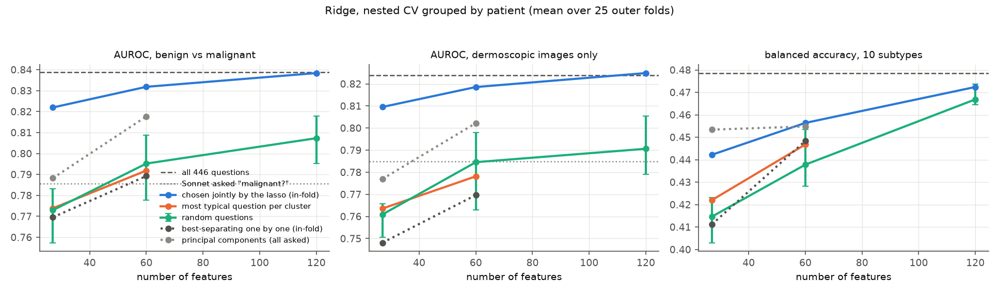

# Ridge without leakage, trimmed question sets, and the frozen final models (2026-11-15)

**Question.** Three things. First, the S9 metadata showed that our folds grouped nothing: every image had its own
`lesion_id`, and 43 patients have more than one lesion in the set. What is ridge's performance when the folds are
grouped by patient, and when everything learned from the data stays inside the training folds? Second, how does it do
on dermoscopic images alone, since clinical photographs make up 6% of benign but 24% of malignant images? Third, can
the 446 questions be cut to the number of independent dimensions found in S9 (27 above noise, 60 for 90% of the
variance) without losing accuracy (PROJECT.md, Plan item 5)? And finally, fit the final models once, on all labelled
images, without scoring them.

## Runs covered

| Run | Experiments (meaning) | Stage hashes |
|---|---|---|
| [20261115-114159_s10-ridge](../../outputs/qaemb/runs/20261115-114159_s10-ridge/report.md) | `D1_train` (all 1,000 beta images), `I1_claude_max` (images shrunk only, to at most 3.6 MP), `Q0_orig` (500 questions as written plus the control question, no negations), `M_topic` (one prompt per topic), `ANS_claude_sonnet` (Claude Sonnet 5.5 through the Batch API, effort low), `G1` (whole image), `R1` (replicate 1). Stage `ridge`. | embed `6cd6f95ebcbd`, ridge `7608bf69bf96` |

Two earlier runs the same morning are superseded. `20261115-113136_s10-ridge` (ridge `03da52e7e270`) did not yet
include the question sets chosen with labels. `20261115-113628_s10-ridge` (ridge `890cabcf2acc`) added the
one-by-one selection but not the lasso, and mislabelled its stability lines. Every number they share with the run above
is identical.

Rerun the same afternoon as `20261115-122004_s10-ridge` (ridge `159decea7f3d`) to also save every out-of-fold
prediction and the scores of the indeterminate images, for the interactive page. All numbers and final models are
identical; paths below point to that run.

No API calls were made.

**What changed before the run.** We added a stage, S10 ridge (`qaemb/stages/s10_ridge.py`, run with `stage=ridge`;
settings under `ridge:` in `conf/base.yaml`), with the question-set selectors in `qaemb/models/selectors.py` and a
figure in `qaemb/models/plots.py`. S6 is unchanged; S10 is now the reference for the main model.

## How we prevented leakage

- **Folds grouped by patient.** Each image's group is its ISIC patient where ISIC records one (472 images) and its
  lesion otherwise. That gives 943 groups for 1,000 images; 43 groups hold 2 to 5 images. No patient is ever on both
  sides of a fold, in the outer folds or in the inner folds that choose lambda.
- **Duplicate pictures.** Every pair of images was compared by a difference hash, a 256-bit fingerprint of the picture
  that survives resizing and recompression. Pairs within 12 bits count as the same picture and are put in one group.
  One such pair exists (two "vascular spider" images, distance 10), and it is already one patient. The next closest
  pairs (25 to 30 bits) are different patients with different diagnoses that just look alike (`duplicates.csv`).
- **Everything inside the folds.** Scaling, lambda, and the choice of questions or principal components are steps of
  one scikit-learn pipeline, refitted on every training split, inner and outer. Questions chosen with labels see only
  the training labels of that split.
- **The final models are not scored.** They are fitted on all labelled images, with lambda chosen by grouped 5-fold CV
  on those images. A score on the same images would mix validation into test (PI, 2026-11-12). Their performance will be
  measured once, on the external test set. The cross-validated scores below are the estimate of what to expect.

As before: 5 repeats of 5-fold, stratified on the 10 subtypes; lambda chosen from 21 values (1 to 100,000; S8) by
3-fold inner CV on log loss. Scores are on all test images and on the dermoscopic test images only. Sonnet's P(yes) to
"Is this a malignant lesion?" is scored on the same folds as a secondary reference.

## Question sets compared

| Set | What it is | Uses labels? |
|---|---|---|
| all | the 446 clinical questions | no |
| lassoK | the K questions the lasso (L1 logistic regression) keeps first on the training split; then refitted with ridge. The lasso chooses questions jointly, so a question that repeats another adds little and is passed over | training labels |
| topK | the K questions that separate the classes best one at a time (ANOVA F-test) on the training split | training labels |
| repsK | Ward clustering of the questions by how alike they are answered, into K clusters; the most typical question of each | no |
| pcaK | the first K principal components of all 446 answers. Not readable, and all 446 questions must still be asked; a reference for "K dimensions" | no |
| randK | K questions drawn at random (5 draws) | no |

K = 27 is the number of dimensions above shuffled noise in S9, and K = 60 the number of components for 90% of the
variance. K = 120 was added for the lasso and random sets, because the S6 lasso kept about 114 questions per fit.

## Results

### Grouping by patient changes the 2-class score little and the 10-class score a little

| Task | Grouped by lesion (as in S6) | Grouped by patient |
|---|---|---|
| Benign vs malignant, AUROC | 0.840 ± 0.030 | **0.839 ± 0.034** |
| Benign vs malignant, specificity at 95% sensitivity | 0.44 | **0.45** |
| 10 subtypes, balanced accuracy | 0.490 ± 0.026 | **0.479 ± 0.034** |

(± is the standard deviation over the 25 outer folds.)

For benign against malignant, the earlier score was not inflated by patients with several lesions. For the 10
subtypes, balanced accuracy drops by about 0.01. The ranges of the five repeats barely overlap: 0.486 to 0.497 grouped
by lesion, and 0.469 to 0.487 grouped by patient. So some of the earlier subtype accuracy probably came from a
patient's other lesions in the training folds. The two groupings use different folds, so this comparison is not
paired.

### Dermoscopic images alone score a little lower

On the 840 dermoscopic images, ridge reaches AUROC 0.824 (against 0.839 on all images) and specificity 0.43 at 95%
sensitivity. On the 10 subtypes it reaches 0.472. The clinical photographs, which are mostly malignant or indeterminate,
make the task slightly easier. Sonnet asked directly scores the same on both (0.786 and 0.785), so the questions keep
their advantage on dermoscopic images: 0.04 AUROC, higher in 21 of 25 folds.

### Trimming: 27 or 60 "independent" questions are not enough; about 120 lasso-chosen questions are

Figure: [performance_vs_questions.png](figures/performance_vs_questions.png).

Benign against malignant, AUROC (mean over 25 folds; difference from all 446 questions on the same folds, and in how
many folds the smaller set scored higher):

| Set | 27 | 60 | 120 |
|---|---|---|---|
| lasso (chosen jointly) | **0.822** (−0.017; 1 of 25) | **0.832** (−0.007; 7) | **0.838** (−0.001; 15) |
| one by one (F-test) | 0.770 (−0.069; 0) | 0.789 (−0.050; 1) | |
| most typical per cluster | 0.774 (−0.065; 0) | 0.792 (−0.047; 1) | |
| random (5 draws) | 0.773 (0.757 to 0.783) | 0.795 (0.778 to 0.809) | 0.807 (0.795 to 0.818) |
| principal components | 0.788 | 0.818 | |
| all 446 questions | 0.839 | | |
| Sonnet asked "Is this a malignant lesion?" | 0.786 | | |

- **Questions chosen by the lasso keep the accuracy.** 120 of them match all 446 (0.838, higher in 15 of 25 folds), 60
  lose 0.007, and even 27 (0.822) are well above asking Sonnet directly (0.786). The same holds on dermoscopic images
  only (120 questions: 0.825 against 0.824).
- **One question per cluster is no better than random.** The 27 or 60 "independent dimensions" describe how the
  answers vary across all images: mostly topic-wide impressions and subtype differences. The diagnostic signal is
  spread over many questions within the clusters. The most typical question of a cluster carries its shared part, which
  is what every other question of the cluster also carries.
- **Picking the best questions one at a time is no better than random either.** The F-test ranks each question alone,
  so it fills the set with near-duplicates of the same few strong questions. The lasso avoids this, which is why it
  works.
- **For the 10 subtypes the picture is the same,** but trimming costs more: lasso 120 reaches 0.472, lasso 60 0.456 and
  lasso 27 0.442, against 0.479 for all 446.

### Which questions are chosen varies between folds

Correlated questions can stand in for one another, so the exact set the lasso picks varies with the training images
(`reps_stability.csv`). For benign against malignant, 14 of the 27 questions were chosen in at least 20 of the 25
folds, and 68 different questions were chosen over all folds. With 120 questions, 57 were chosen in at least 20 folds.
So the number of questions needed is stable, but the particular list is one of several roughly equivalent lists.

## The final models

Fitted on all labelled beta images (800 for benign against malignant, 1,000 for the 10 subtypes), lambda by grouped
5-fold CV on the same images. Saved in `outputs/qaemb/ridge/159decea7f3d/final_models/` (joblib, not in git). Their
question weights are in [final_models/](final_models/) here. **Not scored on the beta images.**

| Task | Set | Questions | lambda |
|---|---|---|---|
| benign vs malignant | all | 446 | 50 |
| benign vs malignant | lasso 27 / 60 / 120 | 27 / 60 / 120 | 33 / 33 / 50 |
| benign vs malignant | most typical per cluster 27 / 60 | 27 / 60 | 33 / 20 |
| 10 subtypes | all | 446 | 100 |
| 10 subtypes | lasso 27 / 60 / 120 | 27 / 60 / 120 | 20 / 33 / 50 |
| 10 subtypes | most typical per cluster 27 / 60 | 27 / 60 | 10 / 20 |

The 27 questions of the final benign-against-malignant lasso model
([s1_2c_lasso27_weights.csv](final_models/s1_2c_lasso27_weights.csv)) mix dermoscopic features with the skin around the
lesion. Towards malignant: chronic sun damage around the lesion, rough skin surface, grey or blue peripheral dots,
dyspigmentation, patchy brown globules, dotted vessels within a network, combined brown and blue-grey or grey-white
structureless areas. Towards benign: a bluish-purple or uniformly vascular lesion, a verrucous surface, a homogeneous or
globular naevus pattern, parallel brown lines. A median question of the list was chosen in 20 of the 25 folds.

## What this means

- **The reported performance of the main model is now AUROC 0.84 ± 0.03, specificity 0.45 at 95% sensitivity**
  (benign against malignant), and 0.82 on dermoscopic images alone. It is grouped by patient, with no step fitted
  outside the training folds. The 10-subtype balanced accuracy is 0.48, slightly below the earlier 0.49.
- **About 120 questions are enough,** if they are chosen jointly. That would cut the cost of answering a new image by
  about three quarters. 60 lose very little (0.007).
- **The number of independent dimensions is not the number of questions needed.** The 27 dimensions above noise
  describe how the answers covary, and much of that is topic-wide (S9). The signal for the diagnosis is not in those
  shared parts but spread over many questions.
- The choice of K = 120 was made after seeing these results, so the trimmed model's score should be confirmed on the
  external test set (PROJECT.md, Evaluation).

## Limitations

- One replicate of Sonnet's answers, topic mode. If a stateless run (Plan item D) changes the within-topic
  correlations, the redundancy between questions, and so the lasso's choices, may change.
- ISIC has no patient for 528 of the images. If some of these share a patient, the grouping still misses them.
- The lasso questions were chosen from answers given in topic mode. Asked alone, or in a shorter prompt, a question may
  be answered differently, so a trimmed questionnaire must be re-answered and re-checked before it replaces the full one.

## Files

- `ridge_summary.md`: the summary the stage writes, with every set on both tasks and both image subsets.
- `summary.csv`: the same in one table (fold mean and spread, pooled per repeat, range over random draws, lambda).
- `paired.csv`: every set against all 446 questions on the same folds.
- `reps_stability.csv`: for each selected set, how often each question was chosen over the 25 outer folds.
- `duplicates.csv`: near-identical image pairs found by the image hash.
- `final_models/`: the final models' question weights, chosen lambda, and a README on how to use them.
- In the stage folder (`outputs/qaemb/ridge/159decea7f3d/`, not in git): also `metrics_folds.csv`,
  `metrics_pooled_by_repeat.csv`, `groups.csv` and the joblib models.
