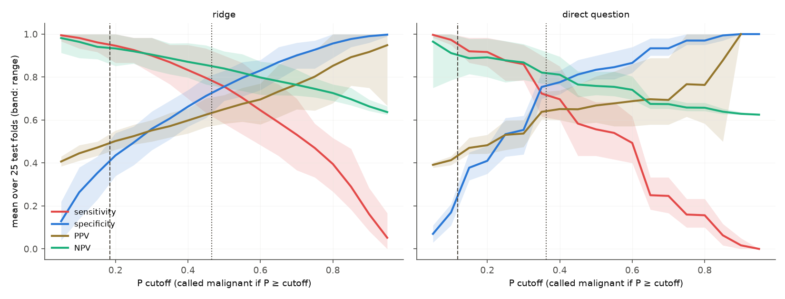

# Which P(malignant) cutoff, and how much the result depends on it (2026-11-16)

**Question.** AUROC needs no cutoff, but every statement about sensitivity or specificity does. Until now the specificity
at 95% sensitivity (0.45, the pre-set main score for benign against malignant) was read at the cutoff that reaches 95% on
each test fold itself, that is, chosen after seeing the test labels. On the external test set the cutoff must be fixed
beforehand. What cutoff would we fix, what does it give on images the model has not seen, and how sensitive are the
results to the exact choice?

## Runs covered

| Run | Experiments (meaning) | Stage hashes |
|---|---|---|
| [20261116-211220_s14-thresholds](../../outputs/qaemb/runs/20261116-211220_s14-thresholds/report.md) | `D1_train` (all 1,000 beta images), `I1_claude_max` (images shrunk only, to at most 3.6 MP), `Q0_orig` (500 questions as written plus the control question, no negations), `M_topic` (one prompt per topic), `ANS_claude_sonnet` (Claude Sonnet 5.5 through the Batch API, effort low), `G1` (whole image), `R1` (replicate 1). Stage `thresholds`. | embed `6cd6f95ebcbd`, ridge `159decea7f3d`, thresholds `6a9b694f5857` |
| [20261116-211352_s9-explore-cutoffs](../../outputs/qaemb/runs/20261116-211352_s9-explore-cutoffs/report.md) | Same experiments. Stage `explore`: the results added to chapter IX of the [interactive explorer](../2026-11-15_answer_structure/explorer.html) as Table 9.10 and Fig. 9.11. | explore `a887c4d68972` |

**What changed before the run.** A new stage, S14 thresholds (`qaemb/stages/s14_thresholds.py`, run with
`stage=thresholds`; settings under `thresholds:` in `conf/base.yaml`). It rebuilds S10's 25 outer folds and refits each
outer model with the penalty S10 chose for that fold; the test-fold predictions matched S10's stored ones exactly
(largest difference 0), so everything below describes the S10 main model.

## How the cutoffs were chosen

Model: ridge on the Directional Score of the 446 clinical questions, benign against malignant, 800 images (300
malignant), folds grouped by patient, 5 repeats of 5-fold. Sonnet's direct answer to "Is this a malignant lesion?" is
treated the same way for reference.

For each outer fold, the training images get cross-validated predictions of their own (3 inner folds grouped by patient,
same penalty). Each rule below is turned into a P cutoff from those training predictions only, then applied unchanged
to the held-out fold:

- **P ≥ 0.5**: no tuning. Because the model is trained with balanced class weights, 0.5 treats the two classes equally.
- **Youden**: the cutoff that maximises sensitivity + specificity.
- **90, 95, 97.5, 99% sensitivity** (rule-out): the highest cutoff that still catches that share of the training malignancies.
- **90, 95% specificity** (rule-in): the lowest cutoff that still clears that share of the training benign lesions.

For the sensitivity rules and Youden, the hindsight version (cutoff read on the held-out fold) is kept for comparison.
Separately, fixed cutoffs from 0.05 to 0.95 were applied to every held-out fold. Every number is a mean over the 25
held-out folds (about 160 images each, about 60 of them malignant), with the range across folds.

## Results

Ridge, all images. Rows marked *hindsight* read the cutoff on the held-out fold.

| Rule | P cutoff | Sensitivity | Specificity | PPV | NPV | Called malignant |
|---|---|---|---|---|---|---|
| P ≥ 0.5 | 0.50 | 0.76 (0.58–0.90) | 0.76 (0.69–0.83) | 0.65 | 0.84 | 44% |
| Youden | 0.47 (0.38–0.58) | 0.78 (0.50–0.93) | 0.72 (0.58–0.83) | 0.63 | 0.85 | 47% |
| 90% sensitivity | 0.28 (0.22–0.31) | 0.91 (0.87–0.98) | 0.53 (0.44–0.62) | 0.54 | 0.91 | 64% |
| **95% sensitivity** | **0.18 (0.15–0.24)** | **0.95 (0.88–1.00)** | **0.41 (0.29–0.49)** | 0.49 | 0.94 | 73% |
| 95% sensitivity, *hindsight* | 0.23 (0.08–0.41) | 0.95 (exactly) | 0.45 (0.24–0.69) | 0.52 | 0.93 | 70% |
| 97.5% sensitivity | 0.12 (0.07–0.19) | 0.98 (0.92–1.00) | 0.30 (0.21–0.39) | 0.46 | 0.96 | 80% |
| 99% sensitivity | 0.07 (0.04–0.12) | 0.99 (0.97–1.00) | 0.18 (0.08–0.32) | 0.42 | 0.98 | 88% |
| 90% specificity | 0.72 (0.69–0.75) | 0.51 (0.37–0.70) | 0.91 (0.84–0.97) | 0.78 | 0.76 | 25% |
| 95% specificity | 0.80 (0.74–0.83) | 0.39 (0.25–0.62) | 0.95 (0.90–0.99) | 0.85 | 0.72 | 18% |

What this shows, in words:

- **With the cutoff fixed from the training images, the model still catches 95% of malignancies on average, and
  clears 41% of benign lesions rather than 45%.** So the honest version of the main score is about 0.41. Single folds
  range from 88% to 100% sensitivity, which is what to expect from about 60 malignant images per fold.
- **The cutoff itself is stable.** Chosen from the training images, the 95%-sensitivity cutoff stays between P = 0.15
  and 0.24 in all 25 folds. Read on a single held-out fold it ranges from 0.08 to 0.41, which is why the hindsight
  figure is optimistic: it partly fits the fold.
- **The results are not fragile to the exact cutoff.** Sensitivity and specificity change smoothly with the cutoff
  (figure below). Between P = 0.15 and 0.30, sensitivity falls only from 0.96 to 0.90 while specificity rises from 0.35
  to 0.56. The Youden cutoff (0.47) is close to 0.5, as the balanced class weights lead one to expect.
- **Dermoscopic images only** give nearly the same picture (95% rule: sensitivity 0.94, specificity 0.42).
- **The direct question is the less robust score to set a cutoff on.** Sonnet's stated P(yes) takes only a few
  distinct values, so its curves move in steps and a small change of cutoff can move many images at once.
- PPV and NPV depend on how common malignancy is: 37.5% of these 800 images. They will differ in a clinic.

*Mean over the 25 held-out folds (lines) and range across folds (bands). Dashed vertical line: the training-split
cutoff for 95% sensitivity; dotted: Youden.*

Full tables, also for the direct question and for dermoscopic images: [rules_summary.csv](rules_summary.csv),
[sweep_summary.csv](sweep_summary.csv), and the run's [summary.md](../../outputs/qaemb/thresholds/6a9b694f5857/summary.md).

## What we do with this

- Report the specificity at 95% sensitivity with the cutoff chosen in the training split (0.41) alongside the hindsight
  value (0.45) from now on. The decision is recorded in PROJECT.md.
- For the external test set, the cutoff for 95% sensitivity is fixed in advance from the final model's cross-validated
  predictions on the beta images, at about P = 0.18, and not adjusted afterwards.
- No single cutoff is imposed. Each reported operating point names the rule and the P cutoff it implies.

## Limitations

The inner predictions come from models trained on about two-thirds of each training split, so they are slightly less
sharp than the outer model's; that is the usual price of choosing a cutoff without touching the test fold. One model
(ridge on all questions) and benign against malignant only; naevus against melanoma and the ten-subtype model are not
yet treated this way.
