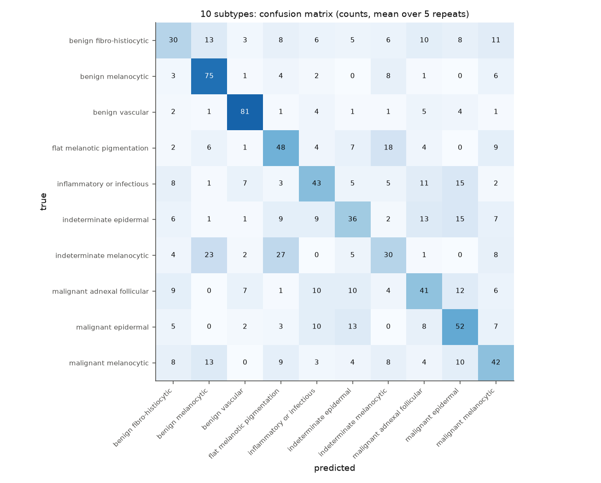
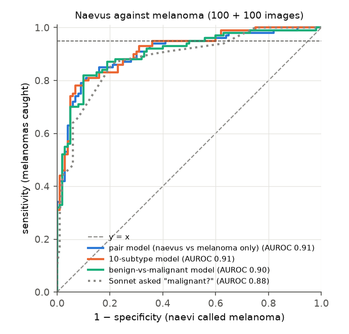

# The ten subtypes in detail, and naevus against melanoma (2026-11-16)

**Question.** Our collaborating dermatologist asked for a direct comparison of naevi and melanomas. Is the
question-based model good at the distinction that matters most among pigmented lesions? We also wanted the full
10-subtype results, since that model is the most specific one we have. Specifically:
- which subtypes the 10-subtype model recognises;
- what it confuses them with;
- whether its errors are clinically sensible.

## Runs covered

| Run | Experiments (meaning) | Stage hashes |
|---|---|---|
| [20261116-193015_s11-subtypes-comparison](../../outputs/qaemb/runs/20261116-193015_s11-subtypes-comparison/report.md) | `D1_train` (all 1,000 beta images), `I1_claude_max` (images shrunk only, to at most 3.6 MP), `Q0_orig` (500 questions as written plus the control question, no negations), `M_topic` (one prompt per topic), `ANS_claude_sonnet` (Claude Sonnet 5.5 through the Batch API, effort low), `G1` (whole image), `R1` (replicate 1). Stage `subtypes`. | embed `6cd6f95ebcbd`, classify `670746415c57`, ridge `159decea7f3d`, subtypes `b4089b614f92` |
| [20261116-182605_s9-explore-metrics](../../outputs/qaemb/runs/20261116-182605_s9-explore-metrics/report.md) | Same experiments. Stage `explore`: the interactive page, with three new chapters drawn from the run above. | subtypes `b88b736bdec8`, explore `d374126c546a` |
| [20261116-204105_s9-explore-skingpt-comparison](../../outputs/qaemb/runs/20261116-204105_s9-explore-skingpt-comparison/report.md) | Same experiments. Stages `subtypes` (version 4) and `explore` (version 3): the model comparison now includes the SkinGPT-R1 benchmarks of S13, and chapter IX of the page leads with it. | bench `84d7b6fd7f04`, subtypes `8925f7ce772b`, explore `79d9482232f8` |

The same afternoon the stage was first run as `20261116-174919_s11-subtypes` (subtypes `4ff0bc60bd81`), and the page built from it as
`20261116-174534_s9-explore-subtypes` (explore `f21e0ac0a1d6`). Version 2 of the stage (`20261116-181530_s11-subtypes-metrics`, subtypes `b88b736bdec8`) added the threshold metrics below, and the
page was rebuilt from it; version 3 (the run in the table) added the comparison over all experiments. Every output the
versions share is byte-identical, so the page, built from version 2, shows the same numbers. Version 4 (2026-11-16, evening, last row of the table) adds the SkinGPT-R1 models of
S13 (`bench` `84d7b6fd7f04`, report [2026-11-16_skingpt_benchmark](../2026-11-16_skingpt_benchmark/README.md)) to the
comparison and numbers every distinct model; again every other output is byte-identical to version 3.

No API calls were made. The new stage takes about 3 minutes.

**All models side by side:** [model_comparison.md](model_comparison.md) lays out AUROC, sensitivity, specificity,
accuracy, F1 and specificity at 95% sensitivity for every model trained so far, from Sonnet's answers or from
SkinGPT-R1, with one table per task. It opens with the ten-subtype models on S10's folds (the questions against
SkinGPT-R1's embeddings and diagnosis), then the training target (two classes, three or ten subtypes), then model
families, answer encoding, leakage controls, number of questions and the naevus–melanoma scores. Each distinct model
(stage, input, classifier, training target, fold grouping) has one number, so the same model is recognisable across
tables, and a model index at the end lists them all. Chapter IX of the
[explorer](../2026-11-15_answer_structure/explorer.html) shows the same tables, with the earlier threshold view in a
dropdown.

**What changed before the run.**
- **New stage S11 subtypes** (`qaemb/stages/s11_subtypes.py`, run with `stage=subtypes`; settings under `subtypes:`
  in `conf/base.yaml`):
  - It reads S10's patient groups and its out-of-fold predictions; nothing earlier is refitted.
  - Its one new model is the naevus-against-melanoma model, which it fits with S10's code and fold design.
- **New ROC figure** (`plots.pair_roc`).
- **Three new chapters on the interactive page:** VII Ten Subtypes, VIII Naevus and Melanoma, and IX Model Metrics.

## What was compared

**Ten subtypes.** The S10 ridge model on all 446 clinical questions:
- trained to predict all ten subtypes at once (100 images each);
- each image assigned to its most probable subtype;
- same validation as before: 5 repeats of 5-fold, grouped by patient, everything fitted inside the training folds.

Per-subtype scores are computed in each repeat on the pooled out-of-fold predictions and then averaged. They are:
- **sensitivity:** of a subtype's 100 images, the share assigned to it;
- **precision:** of the images assigned to a subtype, the share that truly are it;
- **AUROC one against the rest:** how well the subtype's probability ranks its own images above all others. 0.5 is
  chance, 1 is perfect.

**Naevus against melanoma.** The 200 images of two subtypes:
- **benign melanocytic:** 99 naevi and one lentigo simplex. Of these, 15 were excised and read by histopathology; the
  rest were diagnosed by expert consensus, follow-up imaging, or are not recorded.
- **malignant melanocytic:** 100 melanomas, all but five confirmed by histopathology. 25 in situ, 30 invasive, 40 not
  otherwise specified, 5 metastases.

Four scores were compared on the same 200 images, all out of fold (each image scored by a model that never saw its
patient):

| Score | What it is |
|---|---|
| pair model | ridge trained on these 200 images only, with the same nested patient-grouped CV as S10 |
| 10-subtype model | the 10-subtype model above: P(melanoma) / (P(melanoma) + P(naevus)) |
| benign-vs-malignant model | the S10 main model: P(malignant) |
| direct question | Sonnet's P(yes) to "Is this a malignant lesion?" |

The scores are measured as follows:
- **AUROC:** the chance that a random melanoma scores above a random naevus.
- **Specificity at 95% sensitivity:** the share of naevi correctly left alone when the threshold is set to catch 95
  melanomas in 100.
- **Point values:** each is computed within each of the 5 repeats on all 200 pooled predictions, then averaged.
- **Intervals:** a bootstrap over patients (2,000 resamples) on the score averaged over the repeats.

The atypical melanocytic proliferations (the indeterminate melanocytic subtype, 100 images) were never used to fit the
pair model. Each of its 25 outer models scored them.

## Validity checks

These checks are about whether the computation is right, not about how good the model is.
- **The 10-subtype numbers reproduce S10:**
  - balanced accuracy pooled per repeat is 0.479 (0.469 to 0.487 over repeats), the same as S10's `summary.csv`;
  - the two-class model's AUROC pooled per repeat is 0.837, as in S10.
- **Penalty choice:** the pair model's chosen penalty (median lambda 50 over the 25 outer fits) lies inside the grid
  (lambda 1 to 100,000), not at an edge. So the grid was wide enough.
- **Class balance:** every one of the 25 outer test folds of the pair model held at least 20 naevi and 20 melanomas, and no patient appeared on both sides of a fold.

## Results

### Ten subtypes: right in about half of images, near the right answer in most of the rest

Balanced accuracy is 0.479 (chance 0.10). The true subtype is the first choice in 48% of images, among the first two
in 69%, and among the first three in 81%.

| Subtype | Sensitivity | Precision | AUROC one vs rest | Most often taken for |
|---|---|---|---|---|
| benign vascular (haemangioma, angiokeratoma, …) | **0.81** | 0.77 | 0.961 | malignant adnexal follicular (5%) |
| benign melanocytic (naevus) | **0.75** | 0.56 | 0.943 | indeterminate melanocytic (8%) |
| malignant epidermal (squamous cell carcinoma) | 0.52 | 0.44 | 0.883 | indeterminate epidermal (13%) |
| flat melanotic pigmentation (lentigo) | 0.48 | 0.43 | 0.876 | indeterminate melanocytic (18%) |
| inflammatory or infectious (mostly verruca) | 0.43 | 0.47 | 0.839 | malignant epidermal (15%) |
| malignant melanocytic (melanoma) | 0.42 | 0.43 | 0.830 | benign melanocytic (13%) |
| malignant adnexal follicular (basal cell carcinoma) | 0.41 | 0.42 | 0.862 | malignant epidermal (12%) |
| indeterminate epidermal (actinic keratosis) | 0.36 | 0.42 | 0.840 | malignant epidermal (15%) |
| benign fibro-histiocytic (dermatofibroma, polyp, scar) | 0.30 | 0.39 | 0.802 | benign melanocytic (13%) |
| indeterminate melanocytic (atypical melanocytic proliferation) | 0.30 | 0.37 | 0.866 | flat melanotic pigmentation (27%) |

Ranges over the five repeats are narrow (about ±0.03 on sensitivity; `tenclass_per_class.csv`). Confusion matrix:
[figures/tenclass_confusion.png](figures/tenclass_confusion.png).

- **Every subtype is ranked well above chance** (AUROC one against the rest 0.80 to 0.96). Most sensitivities are low
  because similar classes compete for the first choice, not because the signal is missing.
- **The errors are mostly clinically sensible.** 69% of misassigned images stay in the right lineage (melanocytic or
  not, from the ISIC `melanocytic` field). The commonest confusions are:
  - atypical melanocytic proliferations with lentigines (27 of 100) and naevi (23);
  - lentigines with atypical melanocytic proliferations (18);
  - actinic keratosis with squamous cell carcinoma (15) and basal cell carcinoma (13);
  - verruca with squamous cell carcinoma (15).
- **But a subtype error often crosses the benign–malignant line.** Only 25% of errors stay in the right malignancy
  group: melanomas go to naevi (13 of 100) and squamous cell carcinoma (10), and naevi go to the atypical class (8).
- **Training on the finer target costs nothing on the coarse one.** Summing the 10-subtype probabilities into benign
  against malignant (800 images) gives AUROC 0.843, against 0.837 for the two-class model on the same pooling.

### Naevus against melanoma: AUROC about 0.90 for every question-based model; the gain over asking directly is at high sensitivity

Figure: [pair_roc.png](figures/pair_roc.png).

| Score | AUROC (range over repeats) [95% CI] | Specificity at 95% sensitivity (range) [95% CI] | Dermoscopic only: AUROC |
|---|---|---|---|
| pair model | **0.901** (0.884 to 0.910) [0.86, 0.95] | **0.56** (0.53 to 0.62) [0.22, 0.74] | 0.915 |
| 10-subtype model | **0.910** (0.900 to 0.917) [0.87, 0.95] | **0.58** (0.53 to 0.67) [0.32, 0.76] | 0.921 |
| benign-vs-malignant model | 0.898 (0.892 to 0.902) [0.86, 0.94] | 0.47 (0.45 to 0.48) [0.28, 0.73] | 0.900 |
| direct question | 0.883 [0.83, 0.93] | 0.31 [0.22, 0.66] | 0.896 |

Paired differences in AUROC, on the same bootstrap resamples (`pair_differences.csv`):

| Comparison | Difference [95% CI] | Repeats in which the first is higher |
|---|---|---|
| 10-subtype model against direct question | +0.028 [−0.004, +0.060] | 5 of 5 |
| pair model against direct question | +0.023 [−0.013, +0.058] | 5 of 5 |
| benign-vs-malignant model against direct question | +0.020 [−0.020, +0.062] | 5 of 5 |
| pair model against 10-subtype model | −0.005 [−0.017, +0.008] | 1 of 5 |

- **Naevus against melanoma is easier than benign against malignant overall:** AUROC 0.90 here, against 0.84 on all
  800 benign and malignant images.
- **The three question-based models do equally well,** and all beat the direct question in every repeat. With 100
  images per class, though, the AUROC intervals of the differences still include zero. We cannot claim more than "about
  0.02 to 0.03 better" from this set.
- **The clearer gain is at high sensitivity.** Set to catch 95% of melanomas, the question-based models leave 47 to
  58% of naevi alone, against 31% for the direct question. These specificities are uncertain (intervals about ±0.2),
  because they rest on the few hardest melanomas.
- **A model trained on naevi and melanomas only is no better than the 10-subtype model,** which learns them among all
  other lesions (difference −0.005). Training a separate pair model is not worth it.

### Excised naevi are the hard comparison; in situ and invasive melanoma are separated equally well

AUROC, mean over repeats [95% CI] (`pair_breakdown.csv`). Each melanoma type is compared with all 100 naevi, and each
naevus group with all 100 melanomas.

| Subset | Naevi | Melanomas | pair model | 10-subtype | benign-vs-malignant | direct question |
|---|---|---|---|---|---|---|
| melanoma in situ | 100 | 25 | 0.915 [0.86, 0.97] | 0.923 [0.86, 0.98] | 0.876 [0.81, 0.95] | 0.892 [0.82, 0.95] |
| invasive melanoma | 100 | 30 | 0.916 [0.87, 0.97] | 0.913 [0.85, 0.97] | 0.922 [0.86, 0.98] | 0.849 [0.76, 0.93] |
| melanoma, not otherwise specified | 100 | 40 | 0.898 [0.83, 0.95] | 0.917 [0.86, 0.96] | 0.889 [0.81, 0.95] | 0.911 [0.85, 0.96] |
| melanoma metastasis | 100 | 5 | 0.767 [0.44, 0.97] | 0.767 [0.46, 0.97] | 0.933 [0.90, 0.99] | 0.815 [0.52, 0.99] |
| naevi excised (histopathology) | 15 | 100 | 0.807 [0.69, 0.92] | 0.785 [0.66, 0.90] | 0.848 [0.74, 0.94] | 0.785 [0.64, 0.90] |
| naevi not excised (consensus, follow-up, not recorded) | 85 | 100 | 0.918 [0.88, 0.96] | 0.932 [0.89, 0.96] | 0.907 [0.87, 0.95] | 0.900 [0.86, 0.94] |
| dermoscopic images only | 97 | 90 | 0.915 [0.88, 0.96] | 0.921 [0.88, 0.96] | 0.900 [0.86, 0.95] | 0.896 [0.85, 0.94] |

- **Melanoma in situ is separated from naevi as well as invasive melanoma** (pair model 0.915 and 0.916). For the
  direct question, invasive melanoma is the weaker of the two (0.849).
- **Excised naevi are harder:** 0.81 against 0.92 for the others. This is the realistic comparison clinically, since
  these naevi were presumably excised because they looked suspicious. It also means most of our naevi are "easy"
  ones, which flatters every score in this set. There are only 15 excised naevi, so the estimate is imprecise.
- **The five metastases** are too few to assess.
- **Dermoscopic images alone** give the same picture: the 13 clinical photographs, 10 of them melanomas, do not
  drive the result.

### Atypical melanocytic proliferations score between naevi and melanomas

On the pair model's scale (`pair_between.csv`), the median score is 0.15 for naevi, 0.48 for the atypical lesions and
0.87 for melanomas. At the threshold that catches 95% of melanomas (score 0.21), 76% of the atypical lesions would be
flagged, and 41% of naevi.

The two atypical diagnoses differ:
- **Atypical intraepithelial melanocytic proliferations** (37) lie close to melanoma: median 0.64, 84% above the
  threshold.
- **Atypical melanocytic neoplasms** (62) lie nearer the middle: median 0.38, 71% above the threshold.

The pair model never saw either kind. That they fall in order, naevus, atypical, melanoma, supports reading the score
as a graded measure of melanocytic atypia rather than a learned shortcut.

### The questions describe melanoma; a naevus is recognised by what is missing

Each question's AUROC alone on the 200 images (`pair_questions.csv`), with the weights of a pair model fitted on all
200 images (`pair_final_weights.csv`; this model is not scored).
- **Strongly separating questions point almost all one way.** 143 of 446 questions separate the two classes with
  AUROC above 0.75 in the direction of melanoma, but only 2 do so in the direction of naevus.
- **Towards melanoma, the strongest are the classic dermoscopic criteria:** shiny white structures (0.86), white
  structureless areas (0.85), colour asymmetry (0.85), regression structures (0.85), blue-grey ovoid nests (0.84), more
  than two colours (0.84), an atypical vascular pattern (0.84).
- **Towards naevus, the questions describe uniformity:** the lesion dominated by one compact region (0.20, i.e. 0.80
  towards naevus), a flat and subtle melanocytic lesion without melanoma features (0.22), a homogeneous pigmented
  pattern (0.26), a flat macule (0.27).

The questionnaire was written around malignancy criteria, and that shows here: a naevus is recognised by those
criteria being absent.

## Threshold metrics: sensitivity, specificity, accuracy and F1

AUROC measures how well a model ranks cases over every possible threshold. A clinical decision needs one threshold, so
for every model and task we also give the counts at a stated threshold (`metrics_binary.csv`, `metrics_10c.csv`;
chapter IX of the explorer, with a CSV download):
- **sensitivity:** the share of positive cases (malignant, or melanoma) the model flags;
- **specificity:** the share of negative cases it correctly leaves alone;
- **accuracy:** the share of all images it gets right;
- **F1:** the harmonic mean of precision (the share of flagged cases that are truly positive) and sensitivity. It is
  high only if the model both finds the positives and does not over-call them.

Two thresholds are used:
- **P ≥ 0.5:** fixed in advance. The ridge models are trained with balanced class weights, so 0.5 means equal odds.
- **The threshold that catches 95% of the positives:** chosen on the same predictions, so its specificity is slightly
  optimistic.

All values are computed per repeat on the pooled out-of-fold predictions and averaged over the 5 repeats. Pooling
gives slightly different numbers from the fold means: specificity at 95% sensitivity for the main model is 0.43
pooled, against 0.45 as a fold mean.

**Benign against malignant** (300 malignant, 500 benign):

| Model | Threshold | Sensitivity | Specificity | Accuracy | F1 | Precision |
|---|---|---|---|---|---|---|
| ridge, all 446 questions | P ≥ 0.5 | 0.76 | 0.76 | 0.76 | 0.70 | 0.65 |
| ridge, 120 lasso-chosen questions | P ≥ 0.5 | 0.75 | 0.76 | 0.75 | 0.69 | 0.65 |
| ridge, 60 lasso-chosen questions | P ≥ 0.5 | 0.75 | 0.75 | 0.75 | 0.69 | 0.64 |
| ridge, 27 lasso-chosen questions | P ≥ 0.5 | 0.75 | 0.72 | 0.73 | 0.68 | 0.62 |
| Sonnet asked "malignant?" | P ≥ 0.5 | 0.56 | 0.83 | 0.73 | 0.61 | 0.67 |
| ridge, all 446 questions | 95% sensitivity (P ≥ 0.19) | 0.95 | 0.43 | 0.62 | 0.65 | 0.50 |
| Sonnet asked "malignant?" | 95% sensitivity (P ≥ 0.12) | 0.96 | 0.22 | 0.50 | 0.59 | 0.43 |

**Naevus against melanoma** (100 each):

| Model | Threshold | Sensitivity | Specificity | Accuracy | F1 |
|---|---|---|---|---|---|
| pair model | P ≥ 0.5 | 0.79 | 0.87 | 0.83 | 0.82 |
| 10-subtype model | P ≥ 0.5 | 0.78 | 0.89 | 0.84 | 0.83 |
| benign-vs-malignant model | P ≥ 0.5 | 0.70 | 0.93 | 0.81 | 0.79 |
| Sonnet asked "malignant?" | P ≥ 0.5 | 0.46 | 0.96 | 0.71 | 0.61 |
| pair model | 95% sensitivity | 0.95 | 0.56 | 0.75 | 0.79 |
| 10-subtype model | 95% sensitivity | 0.95 | 0.58 | 0.77 | 0.80 |
| benign-vs-malignant model | 95% sensitivity | 0.95 | 0.47 | 0.71 | 0.77 |
| Sonnet asked "malignant?" | 95% sensitivity | 0.97 | 0.31 | 0.64 | 0.73 |

**Ten subtypes.** Each image goes to its most probable subtype, so there is no threshold. With 100 images per subtype,
overall accuracy, balanced accuracy and mean sensitivity coincide:

| Model | Accuracy | Mean specificity | Macro-F1 |
|---|---|---|---|
| ridge, all 446 questions | 0.479 | 0.942 | 0.471 |
| ridge, 120 lasso-chosen questions | 0.472 | 0.941 | 0.468 |
| ridge, 60 lasso-chosen questions | 0.456 | 0.940 | 0.451 |
| ridge, 27 lasso-chosen questions | 0.442 | 0.938 | 0.436 |

Per-subtype sensitivity, specificity, precision and F1 are in `metrics_10c.csv`. Per-subtype accuracy is left out:
with nine negatives per positive it is about 0.9 for every subtype and says little.

- **The direct question is conservative at P ≥ 0.5.** It misses 44% of malignant lesions and 54% of melanomas. Its
  accuracy (0.73 and 0.71) hides this, because it rarely raises a false alarm; F1 shows it (0.61 against 0.70 and
  0.83).
- **The question-based models balance the two errors at P ≥ 0.5:** sensitivity 0.76 and specificity 0.76 for benign
  against malignant, and 0.78 and 0.89 for naevus against melanoma (10-subtype model).
- **Trimming to 120 or 60 lasso-chosen questions** changes these numbers by 0.01 at most. At 27 questions, specificity
  drops by 0.04 at P ≥ 0.5.

## What this means

- **For the dermatologist's question:** on these 200 beta images, the question-based models separate melanoma from
  naevus with AUROC about 0.90. That is a little above asking Sonnet directly (0.88). At the sensitivity a screening
  tool needs, they clear about twice as many naevi (about 56% against 31%). In situ melanomas are recognised as well as
  invasive ones.
- **The weak point is the suspicious naevus:** naevi that were excised score 0.81, and the atypical melanocytic
  lesions sit in between. A fair test needs more excised naevi, or a test set chosen to be hard.
- **No separate naevus–melanoma model is needed.** The 10-subtype model does the job as well, and also gives
  subtype-level output.
- **The 10-subtype model is clinically coherent but not yet a diagnostic tool.** It is right in 48% of images and in
  the top three in 81%, and most errors are between look-alike entities. It also loses nothing on benign against
  malignant (0.843).

## Limitations

- **Small numbers.** 100 images per class; 15 excised naevi; 5 metastases. The bootstrap intervals are given for that
  reason; differences between the question-based models are not resolved.
- **How the naevi were diagnosed.** 85 of the naevi were not excised (consensus, follow-up, or not recorded), while
  95 of the 100 melanomas were confirmed by histopathology. In the clinic, the naevi that need telling apart from melanoma are the excised kind.
- **Same data that chose the design.** The fold design and penalty grid were fixed before this run, but the beta images
  are the same ones used for all earlier choices. The external test set remains the real check.
- **One replicate, topic mode, one answering model,** as in all runs so far.

## Files

- `summary.md`: the summary the stage writes, with every table above.
- `tenclass_per_class.csv`, `tenclass_confusion.csv`, `tenclass_summary.csv`: per-subtype measures with their range
  over repeats, the confusion matrix (counts averaged over repeats), and the per-repeat summary (balanced accuracy,
  top-2 and top-3, errors within lineage and within malignancy group, collapsed two-class AUROC).
- `pair_metrics.csv`, `pair_differences.csv`, `pair_breakdown.csv`: the naevus-against-melanoma scores, paired
  differences and breakdown.
- `pair_scores.csv`: every naevus and melanoma with its four scores (averaged over repeats), diagnosis, confirmation
  method and image type.
- `pair_between.csv`: the atypical melanocytic images with their pair-model score.
- `model_comparison.md`, `model_comparison.csv`: every S6, S10, S11 and S13 (SkinGPT-R1) model scored the same way on
  the three tasks (AUROC; sensitivity, specificity, accuracy and F1 at P ≥ 0.5; specificity at 95% sensitivity), each
  distinct model numbered once (column `no`).
- `metrics_binary.csv`, `metrics_10c.csv`: the threshold metrics, with their range over repeats, on all images and on
  dermoscopic images only.
- `pair_questions.csv`, `pair_final_weights.csv`: each question's AUROC alone and mean answer in each class, and the
  weights of the pair model fitted on all 200 images.
- Interactive version: chapters VII, VIII and IX of the [explorer](../2026-11-15_answer_structure/explorer.html). There
  you can hover any image in the score plot and open it, and open any question on the question map.
