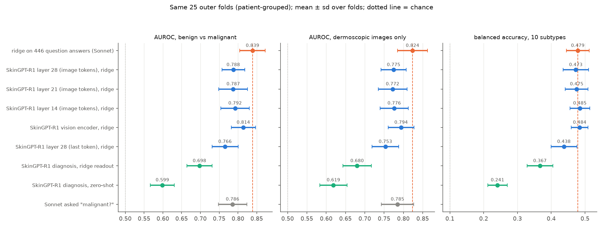
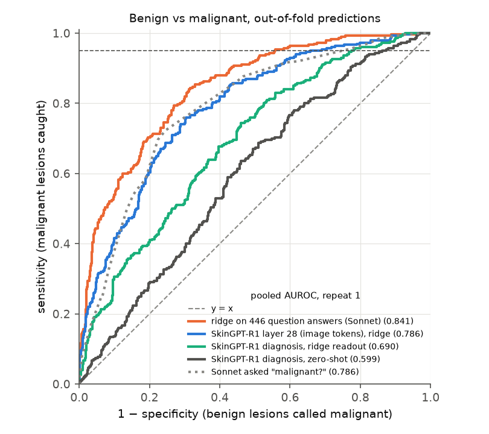

# Ridge on the question answers against SkinGPT-R1, on the same folds (2026-11-16)

**Question.** PROJECT.md, Plan item E (Benchmarks (a)): how does our main model, ridge regression on Sonnet's answers
to 446 questions, compare with an ordinary dermatology image model scored on exactly the same images and folds? Two
uses of SkinGPT-R1 were planned with the PI and post-doc on 2026-11-12: its own diagnosis used as a classifier, and its
image embedding with ridge regression on top, fitted in the same folds as our ridge.

## Runs covered

| Run | Experiments (meaning) | Stage hashes |
|---|---|---|
| [20261116-173808_s13-bench-skingpt](../../outputs/qaemb/runs/20261116-173808_s13-bench-skingpt/report.md) | `D1_train` (all 1,000 beta images), `I1_claude_max` (images for Claude shrunk only, to at most 3.6 MP), `Q0_orig` (500 questions as written plus the control question, no negations), `M_topic` (one prompt per topic), `ANS_claude_sonnet` (Claude Sonnet 5.5 through the Batch API, effort low), `G1` (whole image), `R1` (replicate 1). Stages `vlmfeat` (S12) and `bench` (S13). | embed `6cd6f95ebcbd`, ridge `159decea7f3d` (reused, S10), vlmfeat `a725c88323ae`, bench `84d7b6fd7f04` |

The experiment IDs only select which Sonnet answers and which S10 run the benchmark is paired with. SkinGPT-R1's own
settings are under `vlmfeat:` in `conf/base.yaml` and are part of the vlmfeat hash. Two smoke runs on the 10 smoke
images (`D0_smoke10`) preceded the full run: `20261116-173542_s12-vlmfeat-smoke10` (one candidate order only) and
`20261116-173722_s12-vlmfeat-smoke10` (both orders, the code used here). No API calls were made.

**What changed before the run.** Two new stages. S12 vlmfeat (`qaemb/stages/s12_vlmfeat.py`, `stage=vlmfeat`, GPU)
extracts SkinGPT-R1's embeddings and its candidate-label diagnosis. S13 bench (`qaemb/stages/s13_bench.py`,
`stage=bench`) fits and scores every method on S10's folds. Also new: two methods on the local-model wrapper
(`qaemb/answerers/qwen_vl.py`), two figures in `qaemb/models/plots.py`, and SkinGPT-R1's own classification prompt,
unchanged, as `inputs/prompts/skingpt_classification_v1.txt`.

## What was compared

All methods are scored on the same 25 outer test folds as S10: 5 repeats of 5-fold, stratified on the 10 subtypes,
grouped by ISIC patient, with near-duplicate pictures merged. S13 refits S10's question ridge itself and checks it
against S10's stored scores. It matched in all 100 fold-and-subset rows (largest difference 0), which shows that the
folds are identical (`check_s10.csv` in the stage folder).

| Method | What it is |
|---|---|
| Ridge on 446 question answers | Our main model: S10's `all` set, ridge (L2 logistic regression) on Sonnet's Directional Scores. |
| SkinGPT-R1 embedding, ridge | One forward pass of SkinGPT-R1 per image (at its own evaluation size, about 1 MP, 1,240 image tokens). From its hidden states we take a 3,584-number summary of the image. Ridge on top, with scaling and lambda fitted inside each outer training split exactly as for the questions (3-fold grouped inner CV, log loss). Five summaries: **layer 28, the last layer, averaged over the image tokens (the main one, fixed before the run)**; layers 21 and 14 averaged the same way; layer 0 at the image tokens, which is the vision encoder's output; and layer 28 at the last position, where the answer starts. |
| SkinGPT-R1 diagnosis, zero-shot | SkinGPT-R1 given its own candidate-label prompt ("Analyze the image, reason step by step, and provide the final diagnosis. Choose exactly one diagnosis from: …") with 16 labels. We read the probability of each full label as its answer. Summed over melanoma, basal cell and squamous cell carcinoma, this gives P(malignant). Summed by subtype, it gives the 10-class prediction. Nothing is fitted. |
| SkinGPT-R1 diagnosis, ridge readout | Ridge on SkinGPT-R1's 16 label log-probabilities, fitted in the same folds. This is its diagnosis "trained on our folds": the readout can learn, for example, that its "actinic keratosis" often means squamous cell carcinoma here. |
| Sonnet asked "malignant?" | Sonnet's P(yes) to the control question, as in S10 (secondary reference). |

The 16 candidate labels were chosen before the run from the ISIC diagnoses of the beta images: melanoma, basal cell
carcinoma, squamous cell carcinoma, actinic keratosis, atypical melanocytic proliferation, melanocytic nevus,
seborrheic keratosis, solar lentigo, dermatofibroma, fibroepithelial polyp, scar, hemangioma, angiokeratoma, pyogenic
granuloma, verruca and dermatitis. Seborrheic keratosis is not one of our subtypes. It was added as the usual benign
look-alike and counts as benign. The list and each label's subtype are in `conf/base.yaml` (`vlmfeat.candidates`) and
are worth reviewing with the dermatologist.

## Two choices forced by the model

- **No reasoning.** SkinGPT-R1 is a reasoning model, and its intended use is to write a rationale and then the answer.
  On two smoke images, it reasoned its way to the right label both times ("Melanoma", "Melanocytic nevus"), but greedy
  generation took 840 s for the pair on our Quadro RTX 8000. That would be 4 to 5 days for the 1,000 images. We
  therefore closed its reasoning block empty and opened the answer in the format it writes itself
  (`<answer> Final Answer:`), as our S2 answerer already does for SkinGPT-R1's yes/no answers. On the three images we inspected,
  over 95% of its next-token probability at that point goes to the first token of a candidate label, so the readout
  itself works. The
  zero-shot diagnosis below is therefore **SkinGPT-R1 answering without its reasoning**. It is a lower bound on what
  the model can do, not a fair measure of its reported diagnostic ability.
- **Order of the labels.** Without reasoning, the answer depends on where a label sits in the list. Across the 1,000
  images, the label SkinGPT-R1 puts first is the same with the list as given and reversed for only 47% of images; on
  one smoke melanoma, reversing the list moved it from "Melanoma" to "Pyogenic granuloma". We scored every image with
  both orders and averaged the two log-probabilities (`vlmfeat.orders`). The embeddings come from the image tokens,
  which precede the text in the prompt, so they do not depend on the list at all (apart from the last-token one).

## Results

What the numbers mean: AUROC is the probability that a randomly chosen malignant lesion gets a higher score than a
randomly chosen benign one (0.5 is chance, 1 is perfect). Specificity at 95% sensitivity is the share of benign
lesions correctly cleared when the threshold is set to catch 95% of malignant ones. Balanced accuracy for the 10
subtypes is the mean, over subtypes, of the share of images given the right subtype (chance is 0.10). "± sd" is the
spread over the 25 outer folds; "folds higher" counts the folds in which a method beat the questions on the same test
images.

### Benign against malignant (800 images)

| Method | AUROC, all images | AUROC, dermoscopic only | Specificity at 95% sensitivity | Against the questions: difference, folds higher |
|---|---|---|---|---|
| Ridge on 446 question answers (Sonnet) | **0.839** ± 0.034 | **0.824** ± 0.039 | **0.45** | reference |
| SkinGPT-R1 vision encoder, ridge | 0.814 ± 0.033 | 0.794 ± 0.033 | 0.40 | −0.024, 6 of 25 |
| SkinGPT-R1 layer 14 (image tokens), ridge | 0.792 ± 0.038 | 0.776 ± 0.037 | 0.35 | −0.046, 3 of 25 |
| **SkinGPT-R1 layer 28 (image tokens), ridge (main)** | 0.788 ± 0.030 | 0.775 ± 0.033 | 0.36 | −0.051, 2 of 25 |
| SkinGPT-R1 layer 21 (image tokens), ridge | 0.787 ± 0.038 | 0.772 ± 0.037 | 0.32 | −0.051, 2 of 25 |
| SkinGPT-R1 layer 28 (last token), ridge | 0.766 ± 0.035 | 0.753 ± 0.035 | 0.33 | −0.073, 2 of 25 |
| SkinGPT-R1 diagnosis, ridge readout | 0.698 ± 0.033 | 0.680 ± 0.037 | 0.24 | −0.141, 0 of 25 |
| SkinGPT-R1 diagnosis, zero-shot | 0.599 ± 0.032 | 0.619 ± 0.035 | 0.16 | −0.240, 0 of 25 |
| Sonnet asked "malignant?" | 0.786 ± 0.038 | 0.785 ± 0.042 | 0.27 | −0.053, 1 of 25 |

### Ten subtypes (1,000 images)

| Method | Balanced accuracy, all images | Dermoscopic only | Against the questions: difference, folds higher |
|---|---|---|---|
| Ridge on 446 question answers (Sonnet) | 0.479 ± 0.034 | **0.472** ± 0.042 | reference |
| SkinGPT-R1 layer 14 (image tokens), ridge | **0.485** ± 0.030 | 0.454 ± 0.036 | +0.006, 14 of 25 |
| SkinGPT-R1 vision encoder, ridge | 0.484 ± 0.025 | 0.459 ± 0.032 | +0.006, 13 of 25 |
| SkinGPT-R1 layer 21 (image tokens), ridge | 0.475 ± 0.034 | 0.444 ± 0.037 | −0.003, 10 of 25 |
| **SkinGPT-R1 layer 28 (image tokens), ridge (main)** | 0.473 ± 0.038 | 0.447 ± 0.042 | −0.006, 10 of 25 |
| SkinGPT-R1 layer 28 (last token), ridge | 0.438 ± 0.038 | 0.415 ± 0.048 | −0.041, 3 of 25 |
| SkinGPT-R1 diagnosis, ridge readout | 0.367 ± 0.038 | 0.348 ± 0.050 | −0.112, 0 of 25 |
| SkinGPT-R1 diagnosis, zero-shot | 0.241 ± 0.029 | 0.231 ± 0.028 | −0.238, 0 of 25 |

Full tables, including pooled scores per repeat and macro-F1: [bench_summary.md](bench_summary.md),
[summary.csv](summary.csv), [paired.csv](paired.csv).

### Checks on the fits

- Lambda for the embeddings settled at 500 (range 333 to 2,000) in every fold. That is ten times stronger than for the
  questions, as expected for 3,584 correlated columns, and none of the choices fell on the edge of the grid (lambda 1
  to 10⁷; [lambda_choices.csv](lambda_choices.csv)). For the diagnosis readout lambda was about 5, and one of 25 folds
  chose the edge.
- The question ridge reproduced S10 exactly (above), so its row here is S10's main result.

### Follow-up: the same benchmark as ten-subtype models (added the same evening)

The tables above score benign against malignant with models trained on the two classes. Because the ten-subtype model
on the questions turned out to rank benign against malignant at least as well as the two-class model (FINDINGS 25), the
comparison was repeated with every method's ten-subtype model, read three ways from the same ten probabilities:
malignant subtypes summed against benign subtypes, P(melanoma) / (P(melanoma) + P(naevus)), and the most probable
subtype. These come from the same S13 fits (no new run of S13), scored by S11 in
[model_comparison.md](../2026-11-16_naevus_melanoma_subtypes/model_comparison.md) (sections 1 and 2) and in chapter IX
of the [explorer](../2026-11-15_answer_structure/explorer.html); run `20261116-204105_s9-explore-skingpt-comparison`
(subtypes `8925f7ce772b`, explore `79d9482232f8`). The numbers there are pooled over the folds of each repeat and
averaged over the five repeats, so they differ by up to 0.02 from the fold means above.

| Model (ridge, trained on the ten subtypes) | Benign vs malignant AUROC | Specificity at 95% sensitivity | Naevus vs melanoma AUROC | Ten-subtype accuracy |
|---|---|---|---|---|
| Sonnet's answers, 446 questions | 0.843 | 0.49 | 0.910 | 0.48 |
| SkinGPT-R1 image embedding, layer 28 (prespecified) | 0.803 | 0.38 | 0.890 | 0.47 |
| SkinGPT-R1 vision encoder (layer 0) | 0.824 | 0.39 | 0.879 | 0.48 |
| SkinGPT-R1 diagnosis scores, ridge readout | 0.722 | 0.26 | 0.805 | 0.37 |
| SkinGPT-R1 diagnosis, zero-shot (no training) | 0.636 | 0.20 | 0.802 | 0.24 |
| Sonnet asked directly (no training; reference) | 0.786 | 0.22 | 0.883 | n/a |

Training on the ten subtypes helps the SkinGPT-R1 embeddings more than the questions (layer 28: 0.786 to 0.803 for
benign against malignant, 0.844 to 0.890 for naevus against melanoma), but the order is unchanged: the questions stay
ahead for malignancy, by about 0.02 to 0.04 in AUROC and 0.10 in specificity at 95% sensitivity, and level on the
ten subtypes. The naevus–melanoma differences (0.02 to 0.03) are within the spread of about ±0.04 for 100 images per
class.

## What we conclude

1. **On benign against malignant, the question answers beat every SkinGPT-R1 benchmark on the same folds.** The main
   SkinGPT-R1 embedding (last layer, image tokens) with ridge reaches 0.788 against 0.839, lower in 23 of 25 folds,
   and clears 36% of benign lesions at 95% sensitivity against 45%. Its best embedding, the vision encoder's, reaches
   0.814 and is still lower in 19 of 25 folds. That one was a secondary embedding and is the best of five, so 0.814
   flatters SkinGPT-R1 a little.
2. **On the 10 subtypes the two are level.** SkinGPT-R1's embeddings with ridge (0.47 to 0.49) match the questions
   (0.479), within the fold-to-fold spread of 0.03. On dermoscopic images alone the questions lead by 0.01 to 0.03. A
   generic image representation with a fitted readout sorts the subtypes about as well as the 446 answers do. The
   questions' edge is in the malignancy call, which is the clinically important one.
3. **SkinGPT-R1's dermatology training does not show in its image embedding.** Its vision encoder is almost unchanged
   from Qwen2.5-VL-7B (weights differ by about 0.15%, against 2 to 4% in the language model). Even so, the vision
   encoder's output beats every language-model layer for benign against malignant (it beat the main embedding in 23 of
   25 folds), and deeper layers do no better than layer 14. So the "SkinGPT-R1 embedding" benchmark is in effect a
   general vision model's embedding. It is a fair standard-image-model baseline, but not evidence about what
   dermatology fine-tuning adds. A dermatology-specific image encoder (PanDerm, Benchmarks (b)) is the stronger test.
4. **Without reasoning, SkinGPT-R1's own diagnosis is poor.** Zero-shot it reaches AUROC 0.60 and 24% balanced
   accuracy. It calls most lesions melanoma or solar lentigo whatever they are
   ([diagnosis_top_label_by_subtype.csv](diagnosis_top_label_by_subtype.csv); for example, 44 of 100 vascular lesions
   are called melanoma), and it picks "Dermatofibroma" for none of the 100 fibro-histiocytic lesions, 51 of which are dermatofibromas. Read out by ridge on our
   folds it improves to 0.70 and 37%. This measures SkinGPT-R1 without the reasoning it was trained to do, so it should
   not be reported as SkinGPT-R1's diagnostic ability. To report that, we need the reasoning run (below).
5. **Asking Sonnet directly ("Is this a malignant lesion?") is as good as the main SkinGPT-R1 embedding with a trained
   ridge** (0.786 against 0.788; the embedding was higher in 14 of 25 folds) and better on dermoscopic images
   (0.785 against 0.775). Sonnet was never trained on our labels.

This is 1,000 images and one set of SkinGPT-R1 features, cross-validated, with no external test.

## What is still open

- SkinGPT-R1 with its reasoning, the setting its authors evaluate. On this GPU it is about 7 minutes per image in our
  smoke test, which looks far slower than a 7B model should be (about 1 token per second). The first step is to find
  out why (FlashAttention-2 is not available on Turing; batching, KV-cache handling and the transformers 5 generation
  path are suspects). A subset of about 100 images (10 per subtype) would then give a fair zero-shot number.
- The same embedding benchmark for base Qwen2.5-VL-7B (the S12 stage takes any Qwen2.5-VL checkpoint), to separate
  what SkinGPT-R1's language-model fine-tuning adds. And PanDerm/DermLIP image features, Benchmarks (b).
- Whether combining the question answers with an image embedding adds anything to either alone.
